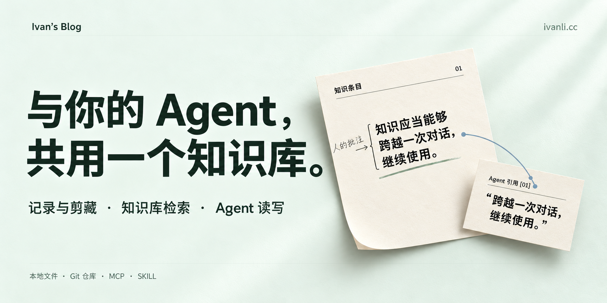

<p align="center">
  <a href="./README.md">English</a> · <a href="./README.zh-CN.md">简体中文</a>
</p>

<p align="center">
  <a href="https://github.com/IvanLi-CN/blog-26/releases"></a>
  <a href="https://github.com/IvanLi-CN/blog-26/actions/workflows/ci.yml"></a>
  <a href="https://github.com/IvanLi-CN/blog-26/actions/workflows/e2e.yml"></a>
  <a href="https://github.com/IvanLi-CN/blog-26/blob/main/package.json"></a>
  <a href="https://github.com/IvanLi-CN/blog-26/blob/main/Dockerfile"></a>
</p>

# Ivan's Blog

Ivan's Blog is a personal knowledge base shared by humans and authorized AI Agents. It keeps notes, source material, project experience, and reusable rules available across reading, writing, and real work; the blog is one selective publishing surface, not the whole product.

The knowledge owner controls what is kept, who can access it, and what can be published. Human interfaces and Agent tools work from the same knowledge with different interaction models and permissions. The current implementation is `active / partial`.

<table align="center" border="0" cellpadding="16" cellspacing="0">
  <tr>
    <td align="center" bgcolor="#f3f0e8">
      <a href="./site/assets/brand/source/ivan-blog-mark.svg"></a>
    </td>
  </tr>
</table>

<p align="center">
  <picture>
    <source media="(prefers-color-scheme: dark)" srcset="./site/assets/projects/social-source/blog-26-dark.png" />
    <source media="(prefers-color-scheme: light)" srcset="./site/assets/projects/social-source/blog-26-light.png" />
    
  </picture>
</p>

## What it does

- **Capture and organize:** maintain Posts, Memos, Projects, Tags, source material, and reusable Playbook rules in the local Markdown content root.
- **Search and cite:** combine keyword, full-text, and available AI retrieval while retaining visibility, source, and fallback boundaries.
- **Publish selectively:** expose chosen Posts, Memos, projects, Playbook entries, and RSS content; private records remain private unless the owner publishes them.
- **Connect authorized Agents:** use the remote MCP surface to read, search, create, and update content within an Agent's granted scope.
- **Process source material:** save authored Memo input first, then run summary and translation asynchronously while retaining the original source and prior successful version.
- **Manage the system:** use the admin console for editing, preview, comments, scheduled tasks, access tokens, AI configuration, and content synchronization.

## How the knowledge base works

1. A person records a note, source, project decision, or reusable rule.
2. An authorized Agent retrieves the relevant record, cites its basis, and applies it to a task.
3. A new understanding or correction can return as a distinguishable Agent contribution for the owner to review and maintain.
4. The owner decides whether the maintained record stays private or becomes a public Post, Memo, project, or Playbook entry.

Shared knowledge is not automatically public. Reading, writing, Agent access, and publication are separate decisions.

## Quick Start

Requirements: Bun `^1.0.0` and Node.js 22.12 or newer for the Astro CLI.

### Deterministic Web Demo

The Web Demo uses shipped application routes, fixtures, mock APIs, and in-memory state. It needs no login, model call, live gateway, or external content source, and its mutations cannot write to a real service.

```bash
bun run setup
bun run web-demo:build
bun run web-demo:preview
```

The public Demo starts at `/memos/`; the admin Demo starts at `/admin/dashboard`. The shared Inspector exposes scene, persona, network, data, simulated actions, share state, and recent in-memory mutations.

### Local development

```bash
bun run setup
bun run dev-sync:trigger
bun run dev
```

`bun run setup` installs checkout hooks, creates the local environment entry point when missing, leases worktree-local ports, and prepares development data. The application reads only the configured local filesystem content root; no remote content-source service is required or started.

## Deployment

The repository ships separate public site, admin SPA, Bun gateway, and full-feature Docker surfaces. Local Markdown is the authoritative content source; SQLite and generated search indexes are derived projections.

Memo clipping saves authored content before asynchronous summary and translation. Administrative search repair and rebuild requests return `202 Accepted` after a durable task is recorded; task and status endpoints expose progress, cancellation, and failure, and retry never publishes a Memo automatically.

Product releases use [Manual Product Release](./docs/runbooks/manual-version-release.md). One release identity covers the static frontend and full-feature Docker image, prepared through a protected `VERSION`-only PR and published as a GitHub Release and GHCR image.

## Repository layout

- `site/`: Astro public site and public install surface.
- `apps/admin/`: Vite/React administration SPA.
- `src/server/`: Bun gateway, HTTP API, tRPC, MCP, and content services.
- `src/lib/`: shared models, search, Playbook, version, and runtime libraries.
- `drizzle/`: SQLite migrations and database configuration.
- `site/assets/brand/source/ivan-blog-mark.svg`: canonical README and public brand mark; install-specific PWA variants are derived separately.
- `tests/`: unit, integration, E2E, and reusable component interaction coverage.
- `docs/`: product specs, implementation records, ADRs, contracts, and runbooks.

## Local verification

```bash
bun run check
bun run test
bun run test:e2e
bun run test:storybook-boundary
```

Page-level evidence uses the official Web Demo routes. Storybook is reserved for reusable components and focused interaction coverage; [quality gates](./.github/quality-gates.json) define the required CI and release checks.

## More docs

- [Product vision and goals](./PRODUCT.md): product purpose, users, goals, shared-knowledge constraints, and non-goals.
- [Context](./CONTEXT.md) and [Glossary](./GLOSSARY.md): stable domain language and public-runtime terminology.
- [Specs index](./docs/specs/README.md): spec hierarchy and the roles of `SPEC.md`, `IMPLEMENTATION.md`, and `HISTORY.md`.
- [Remote MCP Spec](./docs/specs/remote-mcp/SPEC.md): Agent tools, authentication, and content-operation boundaries.
- [Search Spec](./docs/specs/search-relevance/SPEC.md) and [implementation](./docs/specs/search-relevance/IMPLEMENTATION.md): search modes, fallback, visibility, and coverage.
- [Memo clipping Spec](./docs/specs/memo-clipping/SPEC.md) and [implementation](./docs/specs/memo-clipping/IMPLEMENTATION.md): source capture, summary, translation, discussion, and publication boundaries.
- [Content sync HTTP contract](./docs/specs/style-playbook-integration/contracts/content-sync-status.md): asynchronous indexing tasks, progress, cancellation, and terminal states.
- [Style Playbook integration](./docs/specs/style-playbook-integration/SPEC.md): public Playbook snapshots, versions, synchronization, and search boundaries.
- [Architecture decisions](./docs/adr/): durable technical decisions and trade-offs.
- [Runbooks](./docs/runbooks/): release, deployment, synchronization, and recovery procedures.
- [Release contract](./.github/release-contract.json) and [quality gates](./.github/quality-gates.json): release identity, required checks, and branch policy.

## License

[MIT License](./LICENSE)
