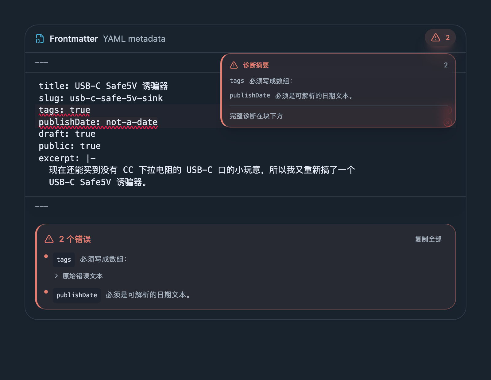
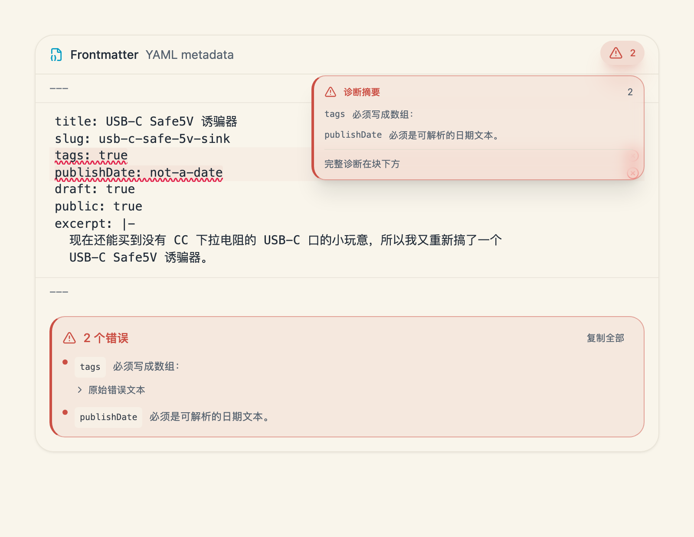

# 管理端错误面与 Frontmatter 诊断详情

> 本文件是长期需求契约；当前实现事实记录在 `IMPLEMENTATION.md`，生命周期与变更引用记录在 `HISTORY.md`。

## Context and Scope

- Context: 管理端承载编辑、配置与运维操作，失败必须可判读、可复制、可定位。当前 Frontmatter 校验详情只在悬停时以内容宽度收缩的浮层出现，错误色仅剩 1px 边框与图标，正文为中性色，浮层在滚动或缩放时立即关闭，且不可选中文本；同一组件内的警告路径还绕过了语义色 token。管理员在保存被阻断时无法稳定读到具体失败原因。
- In scope: `apps/admin` 全部承载错误的界面元素——Frontmatter 诊断详情与常驻诊断列表、错误/警告语义色、诊断计数徽章、错误 Alert 与 Toast 的标题层、可复制原文、触屏可达性，以及语义色 token 的静态检查。
- Out of scope: 访客可见错误的文案过滤与预设注册表（见 [public-error-visibility](../public-error-visibility/SPEC.md)）；响应缓存策略；公开站页面视觉；服务端错误分类逻辑。

## Terms and Interfaces

- `诊断详情`、`常驻诊断列表`、`原始错误文本`、`错误预设` 使用 [GLOSSARY.md](../../../GLOSSARY.md) 中的定义。
- `FrontmatterDiagnostic` 是诊断条目结构，字段包括 `severity`、`message`、可选 `field`、可选 `from`/`to`，定义在 `src/lib/frontmatter-document.ts`。
- `Alert`、`Button`、`Disclosure` 来自本地原语层 `apps/admin/src/components/ui.tsx`；管理端产品代码不得绕过该层。
- 语义色 token 为 `--destructive`、`--warning`、`--success`，经 `apps/admin/src/styles.css` 的 `@theme inline` 暴露为 Tailwind 工具类。

## Requirements

### REQ-AERR-001 — 诊断详情必须常驻可读

- 系统 MUST 在 `FrontmatterBlock` 内提供常驻诊断列表，位于闭合 `---` 之后，不依赖指针位置持续可见。
- 系统 MUST 让列表内容可选中、可复制，不得使用 `pointer-events-none`。
- 系统 MUST 在诊断列表出现时保持 YAML 视觉连续性：列表不得插入在两个 `---` 分隔行之间。
- 系统 MUST 在错误条目为 3 条及以下时默认全部展开；超过 3 条时折叠为摘要行加展开入口。

### REQ-AERR-002 — 诊断详情必须显示字段定位

- 每条诊断 MUST 显示其 `field`（若存在），以等宽小字与消息正文区分。
- 诊断缺少 `field` 时 MUST 以根级标记呈现，而不是留空。
- 原始错误文本 MUST 以可折叠形式提供，保持换行与缩进。

### REQ-AERR-003 — 悬停摘要降级为定位入口

- 悬停诊断徽章或行尾标记 MUST 只展示摘要，而不是完整消息全文。
- 悬停摘要 MUST NOT 在滚动或窗口缩放时无条件关闭，除非锚点已离开可视区域或对应诊断已消失。
- 触屏设备 MUST NOT 依赖悬停：点击徽章 MUST 展开常驻诊断列表并滚动到对应位置。
- 既有以悬停摘要承载全文的交互 MAY 被替换；替换后 MUST 保持“从行内标记可到达完整诊断”的路径。

### REQ-AERR-004 — 悬停摘要宽度必须可预测

- 悬停摘要 MUST 采用内容无关的稳定宽度：`width: min(24rem, calc(100vw - 2rem))`。
- 系统 MUST NOT 以收缩到内容的宽度呈现诊断详情。
- 锚点空间不足时 MUST 水平翻转或其他方向放置，不得压缩宽度。
- 视口夹取 MUST 保证摘要完整落在可视区域内。

### REQ-AERR-005 — 错误必须携带可辨识的错误色

- 错误级诊断 MUST 同时具备四层语义色信号：`--destructive` 边框、低透明度 `--destructive` 背景、起始侧 3px `--destructive` 强调条、`--destructive` 标题与图标。
- 错误正文 MUST 保持中性可读色，不得整段使用错误色。
- 警告级诊断 MUST 使用 `--warning` token，不得硬编码 `amber-*` 类。
- 成功与警告状态点 MUST 使用 `--success`、`--warning` token，不得硬编码 `emerald-*`、`amber-*` 类。

### REQ-AERR-006 — 管理端错误面不得使用未定义 token

- 管理端产品代码 MUST 只引用 `apps/admin/src/styles.css` 实际定义的语义色 token。
- 任一出现过的未定义 token（如 `text-danger`）MUST 改写为其真实对应 token（`destructive`），MUST NOT 以新增别名掩盖。
- `bun run check` MUST 覆盖未定义语义色 token 的静态扫描，格式与既有 `scripts/check-admin-ui-controls.ts` 一致。

### REQ-AERR-007 — 管理员看到完整错误，且分层呈现

- 管理员错误面 MUST 展示技术错误码与原始错误文本。
- 首屏 MUST 只呈现摘要行（技术码加人读消息）；原始文本 MUST 收进可展开区域并可复制。
- 面板级 MUST 提供“复制全部”，按每行一条诊断输出纯文本。
- 管理员错误面 MUST NOT 因长度截断而丢失原始文本。

### REQ-AERR-008 — 错误面必须与本地原语层一致

- 管理端错误展示 MUST 使用 `apps/admin/src/components/ui.tsx` 导出的本地原语，不得自建等价控件。
- 缺失能力时 MUST 先扩展本地原语层，再在产品代码中引用。

## Verification

### VER-AERR-001

- Method: Playwright 用例打开含错误 frontmatter 的文章编辑页，断言常驻诊断列表存在、文本可选择，并校验其位于闭合 `---` 之后。
- covers: `REQ-AERR-001`
- Pass condition: 列表可见且 `window.getSelection()` 可取得诊断文本；DOM 顺序为 CodeMirror 区域在列表之前。

### VER-AERR-002

- Method: 组件用例给定带 `field` 与不带 `field` 的诊断，断言字段名与根级标记分别渲染；展开原始文本断言换行保留。
- covers: `REQ-AERR-002`
- Pass condition: 字段名以等宽样式出现；原始文本容器保持 `whitespace-pre-wrap`。

### VER-AERR-003

- Method: Playwright 用例悬停徽章后滚动，断言摘要仍可见；再以触屏视口点击徽章，断言常驻列表展开并滚动到目标。
- covers: `REQ-AERR-003`
- Pass condition: 滚动后摘要未消失；触屏点击后目标诊断进入视口。

### VER-AERR-004

- Method: 组件用例在两种视口宽度下读取摘要容器计算宽度。
- covers: `REQ-AERR-004`
- Pass condition: 宽度等于 `min(384px, viewport - 32px)`，不随消息文本长度变化。

### VER-AERR-005

- Method: 组件用例读取错误级与警告级容器的计算样式与类名。
- covers: `REQ-AERR-005`
- Pass condition: 四层语义色信号均由 `--destructive`/`--warning` 派生，正文保持中性色，未出现 `amber-*`/`emerald-*` 硬编码。

### VER-AERR-006

- Method: 在 `bun run check` 中运行 token 扫描脚本，并注入一处 `text-danger` 验证其失败。
- covers: `REQ-AERR-006`
- Pass condition: 仓库当前无未定义 token 报告；注入后可稳定报错并以非零退出。

### VER-AERR-007

- Method: Playwright 用例触发生成失败与保存阻断，断言摘要行含技术码，展开后原文可选中，复制全部产出按行文本。
- covers: `REQ-AERR-007`
- Pass condition: 三段断言同时成立，且摘要区高度不随原文长度增长。

### VER-AERR-008

- Method: 运行 `bun run test:admin-ui` 边界回归套件。
- covers: `REQ-AERR-008`
- Pass condition: 扫描未发现自建等价控件。

## Related ADRs

- [ADR 0010: Self-contained console runtime](../../adr/0010-self-contained-console-runtime.md)

## Visual Evidence

- 
- 

## References

- `./IMPLEMENTATION.md`
- `./HISTORY.md`
- [Frontmatter 诊断在 Admin Soft UI 中的既有约束](../admin-soft-ui-redesign/SPEC.md)
