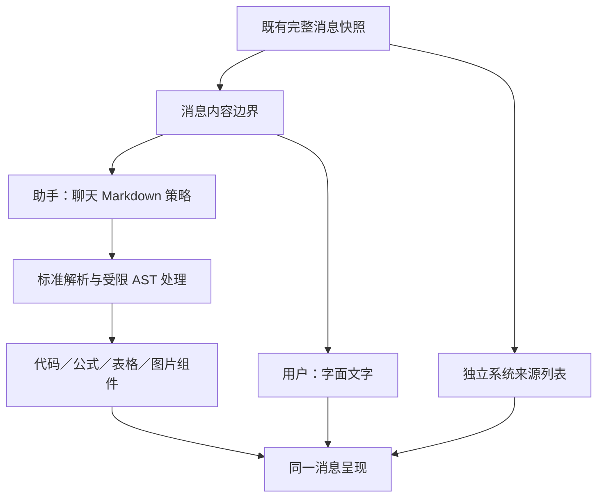

# 助手消息渲染功能与组件设计

本设计服务于 [需求合同](./SPEC.md)。已确认的产品规则与执行边界列于 [决策记录](./DECISIONS.md)；下面定义组件职责与接口，实现进度及验证事实见 [IMPLEMENTATION.md](./IMPLEMENTATION.md)。

## 用户可见行为

| 内容或状态 | 显示行为 |
| --- | --- |
| 用户消息 | 按字面显示星号、反引号、标签与换行；长词可折行，避免撑破消息宽度 |
| 完整助手回答 | 按标准 Markdown/GFM 显示；聊天排版使用 Nature 字体、色彩、焦点与间距 |
| 代码 | 明确块级边界、可读高亮、复制和主动折叠；默认完整展开，保留原始换行 |
| 表格 | 普通文字可换行，超出消息宽度时由表格自身横向滚动 |
| 数学 | 支持美元分隔符，超宽公式局部滚动；解析失败保留可读内容 |
| 外部图片 | 展示替代文字、目标域名和加载/打开入口；点击加载前不产生图片请求 |
| 已授权站内图片 | 通过既有资源边界显示，失败时保留替代文字与必要反馈 |
| 原始 HTML | 作为字面文本显示；不从回答生成 HTML、媒体或交互控件 |
| 来源列表 | 保留独立系统来源列表；裸 `[n]` 不自动跳转，标准脚注按正文定义定位 |
| 生成中 | 未闭合语法允许暂态文本；内容不丢失，不提前赋予不完整链接可点击身份 |
| 停止或失败 | 展示服务端已收到的部分正文与相应状态；不为排版自动重发问题 |

最后两项按已确认 Q6 执行：不要求补齐未闭合语法，不回写补全符号。宽内容与主动折叠按已确认 Q5 执行。

## 呈现层次与交互

每条消息按“发言者／正文／系统来源／生成或错误状态”组织。正文内部有语义标题、段落、列表、表格、代码和公式；不另造与现有 Nature UI 竞争的聊天卡片系统。代码复制和图片加载具有明确可访问名称、键盘焦点和成功或失败反馈，普通操作沿用现有触控合同。

脚注属于单条助手回答的阅读结构。系统来源属于该条消息的外部结构化材料，两者分开显示和编号，不能因都使用数字标记而混淆信任身份。脚注目标及回跳必须在当前消息定位，屏幕阅读器可辨认关联。

用户已在历史位置阅读时，后续文字、公式或图片加载不自动把滚动条拉到底部。用户已经跟随尾部阅读时可继续跟随；主动返回底部后恢复跟随。判断使用既有滚动状态，不因资源尺寸变化重新推断用户选择。关闭、切换与放大时沿用已有阅读位置与生成生命周期。

完整页面导航会重建 React 实例，因此展示状态不能仅依赖组件局部状态。统一助手按当前 principal、对话和消息保存有界的会话级展示元数据，仅包含主动代码折叠选择与滚动位置；不保存正文或图片加载同意。匿名或无存储权限时不启用持久化，登出清除当前身份的展示元数据。普通文章与独立代码组件默认不启用此交接。恢复及尾部跟随使用实际滚动宿主，在内容布局后恢复位置。

Console 的旧剪藏对话在移动端使用抽屉，关闭会卸载消息组件。由仍存活的父阅读页面提供有界内存展示状态，保留同一对话的主动折叠；切换对话或失去讨论权限时隔离或清除。该状态不进入会话存储，不保存正文，也不把外图加载同意跨实例复用。

## 统一正文样式

对话正文采用连续阅读排版。标题、列表和代码通过语义层级区分，引用、表格、代码容器与图片使用直角且不添加装饰阴影。块级间距统一为 `0.75rem`，正文行高为 `1.75`；文字、弱文案、强调色与细边框都取自现有 Nature 主题变量，浅深主题保持相同规则。

引用使用透明背景与左侧竖线，不添加完整外框，不强制斜体；嵌套引用沿用相同规则。表格保留表头和行分隔，代码保留高亮、工具栏及局部滚动，图片状态保留替代文字与加载反馈。各类内容不通过不同圆角或额外卡片形成视觉分组。

正文中的操作使用透明轻量控件和统一焦点轮廓。脚注回跳仅显示线性 SVG 图标，使用“返回正文”作为可访问名称，默认、悬停与按下时均无底色、边框和阴影；桌面精细指针保留至少 `32px` 点击区域，触控环境至少 `44px`。代码和图片操作保留其可见文字标签与原有反馈，普通链接保留下划线。

视觉规则由聊天正文入口集中维护，并限定在 `.conversation-markdown` 内。共享代码高亮、图片组件与表格工具继续承担原有功能，聊天样式不得修改文章或 Memo 的呈现。可控样式总览同时展示上述内容，作为整体一致性的组件验收入口。

## 数据流与职责

该图描述代码职责，不表示要在产品聊天中开启 Mermaid。输入继续是已存在的完整消息快照，模型端 SSE、服务端保存、轮询或旧剪藏 snapshot 订阅均维持原合同。

| 边界 | 建议职责 | 明确不承担 |
| --- | --- | --- |
| `AssistantMessageContent` | 发言者分流、生成/终态处理、单消息错误边界、稳定消息身份 | 获取模型 Token、取消服务端任务、重新发送消息 |
| `ConversationMarkdown` | 聊天策略、GFM/数学、允许属性、消息内锚点、受限资源行为 | 文章编辑器纠错、引用编号猜测、持久化转换后正文 |
| 共享 Markdown 工具与组件 | 安全 URL、文本提取、表格容器、代码阅读与可访问操作 | 默认开放文章 HTML/视频能力 |
| 消息列表 | 列表身份、阅读位置、尾部跟随、对话切换 | 每条消息重复设置全局事件和滚动策略 |
| 来源列表 | 展示系统记录的标题、位置和安全链接 | 根据 `[n]` 或普通链接制造可信来源 |

建议正文入口输入为 `{ messageId, presentationId, role, content, status }`。这些是前端适配数据，不新增 API 字段；现有消息 status 保持 `pending/streaming/completed/failed/cancelled`。系统或工具内部消息沿用现有可见性规则，不因新增渲染器默认公开。旧剪藏部分内容尚无持久消息 ID 时，使用该订阅中稳定的局部身份，完成后切换到真实消息身份，不能自行修改服务端 ID。

## 解析与内容保真

聊天直接使用原始正文，跳过 `cleanMarkdownContent`。顺序按“标准数学/GFM 解析 → 原始 HTML 节点字面化 → Markdown 到安全展示树 → 净化及受限资源处理 → 公式与高亮 → React 组件”设计，具体插件顺序通过锁定版本的回归确认。禁止先把整段字符串中的反斜杠、美元符或 ` ` 做全局替换。

原始 HTML 字面化在语法树的 HTML 节点上进行，不能用正则替换所有尖括号，从而误伤自动链接、代码或普通数学文本。公式引擎不启用受信任扩展；公式输出与净化规则一并检查。图表围栏仍作为普通代码呈现。

块级代码依据 `pre/code` 或对应 AST 节点判断，语言标签只选择高亮。保留完整标签，未知标签回退普通代码。复制从代码的源文本值取值，不从含按钮、高亮或折叠预览的容器 `innerText` 反推；只去除解析器明确附加的结构标记，不任意 trim 用户代码。折叠是消息内主动选择，未主动操作时不随行数变化自动收起。现有 CodeBlock 可以扩展受控初始状态与复制操作，文章原有默认折叠行为通过显式策略保留。

链接的 href/title 与列表 start，以及脚注所需的 id、ARIA 和必要 data 属性，使用受限属性集转发，不能直接透传任意原始 props。锚点前缀同时包含呈现实例身份和消息身份，标题、脚注引用、定义、aria 关联及回跳使用同一映射；若 sanitizer 改写 ID，所有关联边必须一致。不同消息使用相同脚注名也不冲突。

普通站内链接沿用现有公开路由解析，外链经过协议校验并使用安全跳转属性。只有足够的资源上下文才解析相对图片路径，不能把第一条来源的目录假定为整条回答的资源基址。无法可靠解析时保留文字及不可用反馈，不猜测文件位置。

## 图片状态与请求控制

图片先经 URL 协议与现有授权资源解析器分类。任意同源地址、重写成同源的外链或模型提供的 MIME 描述不构成已授权证明；展示层不扩大后台资源代理或抓取能力。

外图采用 `awaiting-action → loading → loaded/error` 的局部状态。在 `awaiting-action` 状态不设置真实 img src、srcset、预加载或远程探测；用户选择加载后才发出已校验 HTTPS 请求。授权只覆盖本呈现实例中的该条消息与该个确切 URL，URL 变化重新等待选择，不持久化为全站或域名白名单。用户也可直接打开链接。打开外部页面不等于授权后续图片自动加载。

已获准站内资源沿用既有访问控制和 facade，不新增公开化端点。图片加载控件、替代文本、错误反馈与灯箱均遵守相同请求边界；灯箱不能顺便加载本回答中其他未选外图。图片成功或失败只影响相应内容，不打断整条消息。

## 增量快照与错误处理

统一入口当前在每次请求完成后，生成期间等待约 650ms 再轮询完整快照，实际更新间隔还包含请求耗时。初步实现以稳定 message ID 和原文字符串缓存跳过未变化消息，保持 props 和组件边界稳定；先不跨快照拼接自创 AST，也不插入推测性的闭合符。

每次变化交给标准解析器，已完整语法正常显示，未闭合内容允许可读暂态。只有当前合法 AST 链接能够点击，半个地址不能触发导航。输入变为 completed/failed/cancelled 时直接使用最新服务端正文，清理可能的延迟工作，不能让旧的异步渲染覆盖终态。此处不新增持久版本号或传输字段。

错误边界在单消息层隔离异常，保留该条原文和简洁的显示失败反馈；相邻消息、输入框、停止与重试继续可用。公式或高亮能局部降级时优先局部处理。页面关闭只释放呈现与订阅资源，不改变生成状态；手动重试继续调用既有明确操作。

## 响应式与主题

遵循 [DESIGN.md](../../../DESIGN.md)、[Nature UI](../nature-front-ui/SPEC.md) 与 [ADR 0003](../../adr/0003-public-mobile-content-stream.md)。聊天标题、段落和列表按消息密度调节，不直接继承文章正文的大段间距。所有子内容以消息容器宽度为上限，长 URL 可折行；代码、表格和数学各自处理溢出，不让整页横向滚动。

桌面按现有 1440×1000 完整对话验收，小屏覆盖 393×852，并以 320×800 检查窄屏退化；同时检查面板、移动抽屉和 Console 可达剪藏入口。覆盖亮/暗主题、键盘焦点、减少动态、软键盘和复制反馈。主题规则复用现有变量，避免引入另一份代码高亮主题覆盖 Nature 颜色。

## 功能验收与交接

格式 fixtures 必须明确原文、对应发言者、生成状态及期望语义。单测检查解析与状态边界，组件测试检查属性与操作，正式路由 Web Demo 检查多消息、来源区分、外部请求与布局。表格、脚注和代码断言定位准确消息正文，不能把来源列表当正文列表通过。

网络验收覆盖首次呈现零外图请求、点击后仅选择图片请求、URL 变化重新等待、错误反馈和灯箱。增量样本依次提供半围栏、半链接、半公式及最终正文，并对照一次性终态结果。终态源文、复制结果与服务端保存保持一致。

产品实施完成后按 `ui-visual-evidence` 交付受控证据；设计文档没有界面改动，本轮不以文档检查冒充浏览器或视觉验收。真实程序截图仍逐次明确目标与范围。任务文件所有权和依赖保留在正式编排账本，需求文件不复制临时排期或 PR 状态。
