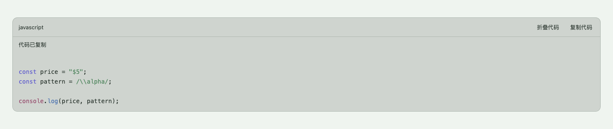
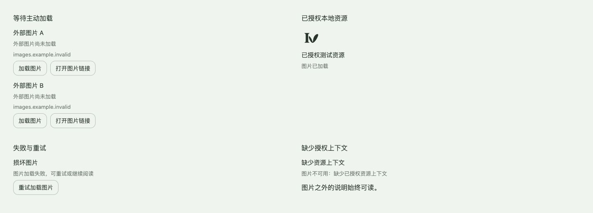
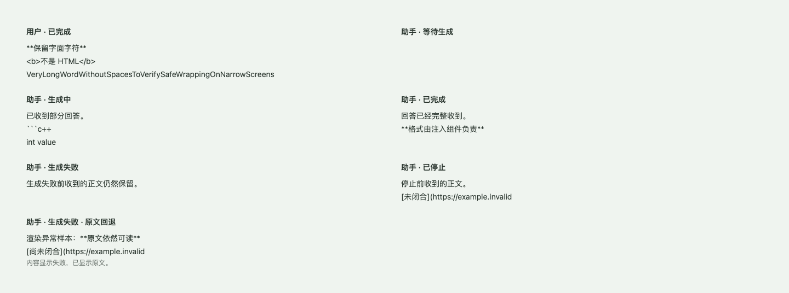
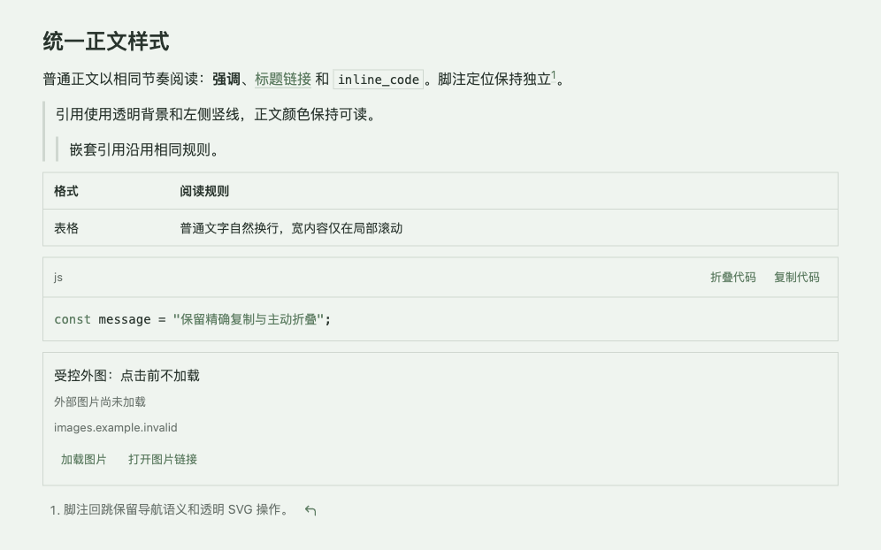
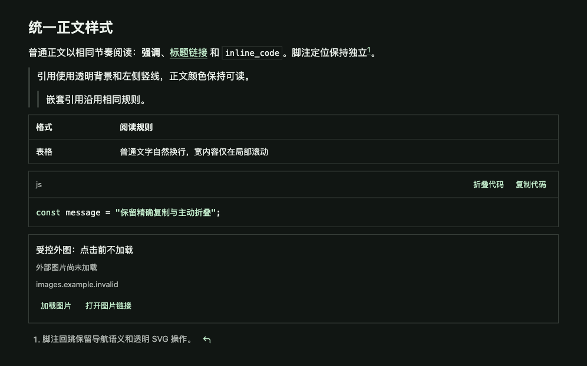

# 助手消息渲染

本文定义助手对话中消息正文的显示合同。功能与组件设计见 [DESIGN.md](./DESIGN.md)，选型依据见 [TECHNOLOGY.md](./TECHNOLOGY.md)，当前实现与验证事实见 [IMPLEMENTATION.md](./IMPLEMENTATION.md)。本文只收录已确认需求，设计访谈留在 [DECISIONS.md](./DECISIONS.md)。

## Context and Scope

- Context: 助手回答需要正确表达列表、强调、代码、公式和来源信息，用户输入需要保留原意；一般对话与剪藏对话在不同呈现入口中保持相同内容规则。
- In scope: 用户消息、助手回答、CommonMark/GFM、代码高亮与复制、数学公式、消息内定位、受限内容与图片加载策略，以及与既有生成生命周期的兼容。
- Out of scope: Mermaid 图表执行、音视频嵌入、交互式嵌入、任意 HTML 执行、聊天框架替换、生成传输协议迁移、对话数据库迁移、发布与部署。私人对话归属、额度、生成与重试继续由站内知识助手主题定义。

## Terms and Interfaces

- 领域术语以 [GLOSSARY.md](../../../GLOSSARY.md#站内知识助手) 为准。用户消息、助手回答和系统保存的来源信息具有不同含义。
- Interface: 既有消息正文、消息身份、生成状态与结构化来源记录；完整对话页、悬浮面板、移动抽屉和仍可达的剪藏对话界面。
- 用户输入和模型回答均不得因视觉渲染而回写为转换后的 HTML；原消息仍是恢复、复制与排查的依据。

## Requirements

### REQ-AMR-001 — 按发言者保留正文语义

- 用户消息 MUST 显示原始字面字符和换行，不解析其中的 Markdown 或原始 HTML。
- 助手回答 MUST 使用本主题约定的 Markdown 显示规则。相同助手回答在不同对话入口的内容规则必须一致。

### REQ-AMR-002 — 标准语法与转义

- 助手回答 MUST 支持 CommonMark 的标题、段落、强调、强强调、引用、分隔线、链接、图片、行内代码及围栏和缩进代码块。
- 普通单换行 MUST 遵循段落软换行语义，空行划分段落，行末双空格或反斜杠形成硬换行。
- 合法反斜杠转义 MUST 保留字面语义。显示层不得全局取消转义、替换代码内容，或将文章编辑器的格式修复套用于聊天正文。

### REQ-AMR-003 — GFM 与消息内定位

- 助手回答 MUST 支持删除线、自动链接、表格、只读任务列表和脚注；有序列表必须保留源文声明的起始序号及嵌套关系。
- 每条消息的脚注、引用锚点与回跳目标 MUST 在当前页面实例内唯一，且可用键盘访问。不同消息和多个同时挂载的对话呈现不得串跳。
- 脚注 MUST 保留引用、定义与回跳所需的标识和可访问属性；脚注与系统来源列表不得混为同一种编号。

### REQ-AMR-004 — 代码阅读与复制

- 带语言、无语言、未知语言的围栏代码及缩进代码 MUST 保持块级语义；语言标签不得因包含 `+`、`-` 等字符被错误截断。
- 支持的语言 MAY 提供语法高亮；无法高亮时 MUST 显示可读代码，不能使整条消息无法阅读。
- 每个代码块 MUST 提供可访问的复制操作，复制源代码正文，不能包含按钮文字或高亮生成的标记。复制失败必须给出可辨认反馈，不能假报成功。

### REQ-AMR-005 — 数学公式

- 助手回答 MUST 支持 `$…$` 行内公式与 `$$…$$` 数学显示语法；多行公式块使用独立行的双美元分隔符。
- 字面美元符 MUST 可通过 `\$` 表达；代码内的美元符和反斜杠不得被当作公式改写。不进行货币含义猜测或全局 TeX 分隔符转换。
- 无效公式 MUST 可读降级，不能隐藏整条回答。公式生成内容必须遵守本主题信任边界。

### REQ-AMR-006 — 助手内容信任边界

- 助手正文 MUST 作为不受信任的展示输入。原始 HTML、脚本、事件处理器、iframe 及可执行 URL 不得形成执行入口。
- Markdown 链接 MUST 经过协议与目标校验；站内正常导航、外部链接安全跳转及必要的无跟踪属性遵守现有公开阅读合同。
- 标准 Markdown 产生的只读任务控件、公式及组件 UI 不属于允许回答提供任意 HTML 的授权。

### REQ-AMR-007 — 图片与外部请求

- 已获准的站内图片 MUST 通过现有资源访问边界显示，不能仅凭同源 URL 推断资源已获授权。
- 外部图片 MUST 先呈现可辨认的链接或占位，只有用户主动操作后才能发起该图片的加载请求；不得预取、自动探测或借助图片代理绕过这一选择。
- 图片不可用或未加载时 MUST 保留替代文字与可继续阅读的正文。图片加载不得授予其他外部资源自动加载的权限。

### REQ-AMR-008 — 正文与结构化来源分离

- 正文中的文字、编号或普通超链接 MUST NOT 自行获得系统来源身份。只有系统返回的结构化来源信息可以进入来源列表。
- Markdown 脚注 MUST 按正文内定义关联。不存在显式可信编号映射时，不得猜测正文编号与来源列表数组位置的对应关系。
- 本主题 MUST 保留独立来源列表，正文裸编号如 `[3]` 不自动成为来源跳转；标准 Markdown 引用链接或脚注仍按其定义处理。新增服务端编号映射不在本主题范围内。

### REQ-AMR-009 — 既有对话生命周期

- 消息显示 MUST 遵守 [站内知识助手](../site-knowledge-assistant/SPEC.md) 的归属与生成生命周期；关闭、导航、切换界面、刷新或短暂断线不得因渲染层改动而重复提交或取消生成。
- 显示层 MUST 保留服务端已记录正文和完成、停止、失败状态，不得为了补齐排版语法而改写持久记录。

### REQ-AMR-010 — 宽内容与主动折叠

- 表格普通文字 MUST 能换行，超宽表格、代码和公式 MUST 在自身容器内横向滚动，不得撑破整个消息或页面。
- 代码 MUST 保留源文换行且默认展开。用户 MAY 主动折叠，不能因生成期间行数增长或终态到来而自动收起正文。
- 内容更新和异步资源加载 MUST 尊重用户已选择的阅读位置；用户阅读历史时不得自动拉回底部，主动返回尾部后可恢复跟随。

### REQ-AMR-011 — 未闭合语法与单消息降级

- 生成期间未闭合链接、公式等 MAY 暂时显示为可读文本；完整语法到来后 MUST 呈现对应结果。不得为提前形成排版而回写推测性的闭合符。
- 未完整或无效的链接 MUST NOT 产生推测性跳转。停止、失败和完成时，最终显示必须采用最新服务端正文，旧的延迟工作不得覆盖终态。
- 渲染异常 MUST 限于相应内容或单条消息，并保留可读原文与必要反馈；相邻消息及发送、停止、重试操作不能被异常阻断。

### REQ-AMR-012 — 统一正文视觉

- 助手正文 MUST 使用统一的主题配色、块级间距、细边框和键盘焦点规则；标题、列表、代码与普通文字保留各自的语义层级。
- 引用、表格、代码与图片等块级内容 MUST 使用直角边界且无装饰阴影，不继承网站卡片的有机大圆角。引用 MUST 使用透明背景与左侧竖线，不强制斜体或添加其余三边框。
- 正文操作 MUST 使用透明的轻量控件。脚注回跳 MUST 显示线性 SVG 图标，不显示 emoji 或可见文本，并保留可访问名称、原有目标、触控区域与键盘焦点提示。
- 同一规则 MUST 适用于浅色、深色、桌面和移动端，不改变文章、Memo 或其他正文消费者的样式。

## Verification

### VER-AMR-001 — 语法与发言者

- Method: 使用相同原文分别渲染用户消息与助手回答，覆盖换行、转义、段落、嵌套列表、有序起始序号、任务列表、删除线和脚注；检查准确正文节点。
- covers: `REQ-AMR-001`, `REQ-AMR-002`, `REQ-AMR-003`
- Pass condition: 用户显示字面原文，助手显示相应语义；页面多消息与多呈现之间的定位互不干扰，任务列表不可编辑。

### VER-AMR-002 — 代码与公式

- Method: 覆盖无语言、未知语言、特殊语言名、缩进块、空代码、复制成功与失败、行内及块级公式、无效公式、转义美元符和代码中的数学标记。
- covers: `REQ-AMR-004`, `REQ-AMR-005`
- Pass condition: 块级代码、复制正文与公式语义正确；高亮或公式失败仅影响相应内容，不使消息消失。

### VER-AMR-003 — 信任边界与外部请求

- Method: 使用可控危险链接、原始 HTML、事件属性、iframe、站内授权及未授权资源、外图和损坏图片样本，同时检查 DOM 与网络请求。
- covers: `REQ-AMR-006`, `REQ-AMR-007`, `REQ-AMR-008`
- Pass condition: 无执行入口或未经选择的外图请求；来源身份不能由正文伪造；未加载与加载失败都有可读反馈。

### VER-AMR-004 — 生命周期兼容

- Method: 在一般对话与仍可达的剪藏入口组合验证生成中切换、关闭、恢复、完成、主动停止及失败，检查服务端状态和提交次数。
- covers: `REQ-AMR-009`
- Pass condition: 相同消息保持连续，原文及终态不被渲染层更改，没有因重渲染引起重复请求或取消。

### VER-AMR-005 — 布局、阅读位置与操作

- Method: 在完整界面、悬浮面板、移动抽屉与可达剪藏入口，覆盖亮暗主题、桌面 1440×1000、小屏 393×852 与窄屏 320×800；组合长代码、宽表格、公式、加载图片、历史阅读、尾部跟随与主动折叠。
- covers: `REQ-AMR-010`
- Pass condition: 页面无横向溢出，滚动局限于对应内容；代码初始展开、操作可达，后续快照不重置主动选择或拉走历史阅读位置。

### VER-AMR-006 — 增量与降级一致性

- Method: 依次输入未闭合围栏、链接、表格、公式及终态快照，组合停止、失败和恢复；注入单消息或局部插件异常，与一次性终态结果比较。
- covers: `REQ-AMR-009`, `REQ-AMR-011`
- Pass condition: 已收到内容保持可读，未形成错误跳转，终态采用最新原文；异常不波及其他消息，持久数据及提交次数保持正确。

### VER-AMR-007 — 正文样式一致性

- Method: 在可控组件总览中同时呈现普通正文、链接、行内代码、引用及嵌套引用、表格、代码及操作、图片状态和脚注，核查浅深主题与桌面、移动端的 computed style 和可见效果。
- covers: `REQ-AMR-012`
- Pass condition: 各块使用相同的间距、边框与主题规则；引用仅有左侧竖线；块级边界直角且无阴影；回跳图标在默认、悬停和按下时均无底色，并可用键盘返回正文。

## Related ADRs

- [ADR 0036：生成独立于 UI 生命周期](../../adr/0036-assistant-generation-independent-of-ui-lifecycle.md)
- [ADR 0037：剪藏讨论属于统一对话](../../adr/0037-unified-assistant-and-clipping-conversations.md)
- [ADR 0040：助手内容与媒体请求信任边界](../../adr/0040-assistant-content-and-media-trust-boundary.md)

## References

- [功能与技术设计](./DESIGN.md)
- [技术选型](./TECHNOLOGY.md)
- [现有能力与缺口](./CAPABILITY-MATRIX.md)
- [实现覆盖](./IMPLEMENTATION.md)
- [兼容背景](./HISTORY.md)

## Visual Evidence

以下组件证据来自当前 Storybook Canvas 的可控输入，已由主人确认准确并同意纳入本轮 PR。视口为 1440×1000 CSS px；捕获范围仅含声明的组件展示面，不含真实对话、系统桌面或无关程序。页面接入与最终 Markdown 渲染仍需单独验证。

### 代码复制

来源：`public-conversation-code-block--copy-success`；剪贴板使用 Story mock，验证复制成功反馈与默认展开。展示面采用主题实色背景及约 29 px 外边距。

### 图片状态

来源：`public-conversation-image--state-gallery`；图片传输由 Story 控制，覆盖授权、待选择、加载失败与重试状态；真实请求隔离由后续浏览器网络回归验证。展示面外边距为 32 px。

### 消息状态与降级

来源：`public-conversation-message-states--overview`；使用简化预览渲染器，覆盖用户字面输入、生成状态、停止、失败及单消息降级，不能替代最终 Markdown 语义验收。展示面外边距为 48 px。

### 统一正文样式

来源：`public-conversation-markdown--style-consistency` 与 `public-conversation-markdown--style-consistency-dark`；使用 1440×1000 CSS px 组件画布，展示正文、链接、行内代码、嵌套引用、表格、代码操作、外图待加载与脚注回跳。图片占位不发起外图请求，操作保持透明，内容边界统一直角。两张完整总览已由主人确认；同一内容另以 `style-consistency-mobile` 在 393×852 验证。独立代码、图片及消息状态 Story 展示的是各自功能状态，聊天入口内的最终组合样式以本组总览为准。
