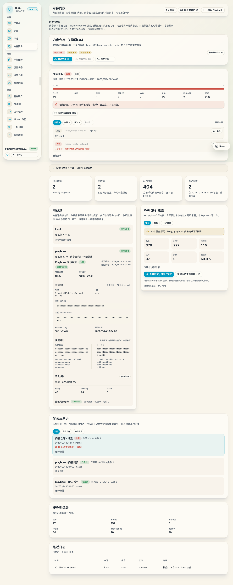
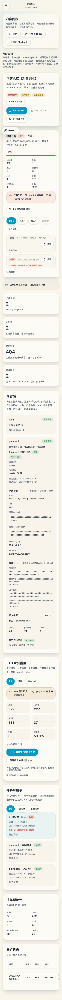
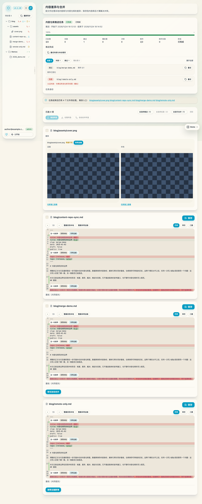

# 内容库与内容仓库双向同步

> 本文件是长期需求契约。当前实现事实见 `IMPLEMENTATION.md`；生命周期与替换背景见 `HISTORY.md`。

## Context and Scope

- Context: 文章与 Memo 仍由本地文件源扫描入数据库，同时编辑器直接写库。两个写入者并存使保存可能被文件扫描回填覆盖，内容也没有可核对的异地副本。本主题把内容权威收敛到数据库，并以一次手动 Git 交互与对等的私有内容仓库同步。
- In scope: 数据库内容库作为唯一权威；私有内容仓库作为对等副本；规范化形态、同步基线、内容差异状态、推送、拉取、三方合并、差异对比与合并界面、媒体文件存储、管理端形态、配置与安全，以及本地内容源退役的原子切换。
- Out of scope: Style Playbook 的 GitHub 读取与采用由 [Style Playbook 集成](../style-playbook-integration/SPEC.md)拥有；项目详情正文是站点代码内的 MDX，不属于内容库；静态站发布合同、RAG 语义索引与检索排序由相邻主题拥有；多管理员与审核流程不变。

## Terms and Interfaces

- `内容库`: 数据库中持有文章、Memo 与剪藏材料的权威内容集合。这些内容引用的媒体文件保存在本地媒体存储，由内容库记录其身份。
- `本地媒体存储`: 保存内容引用附件的本地文件系统位置。它不是内容源，不被扫描为内容，也不参与内容差异比较；内容库记录每个附件的 sha 与大小。
- `内容仓库`: 与内容库双向同步的私有 GitHub 仓库，是内容库的对等副本。两侧都以同步基线为准合并差异，任何一侧都不是无条件权威；内容仓库不是内容源，不参与访客阅读、搜索或快照构建。
- `内容同步面`: 管理端统一观察内容源与内容仓库的界面概念。它不表示两者具有相同的内容权威；内容仓库仍不是内容源。
- `规范化形态`: 正文与 frontmatter 的唯一规范表示，同时用于推送字节、同步基线与差异计算。
- `同步基线`: 某内容最近一次两侧一致时的规范化形态，以及对应的媒体 sha 清单与远端 blob sha。
- `内容差异状态`: 已同步、待推送、待拉取、合并冲突、远端新增、远端删除。
- `合并冲突`: 两侧相对同步基线改动同一位置且无法自动合并的差异，必须由管理员在差异对比中裁决。
- `媒体文件`: 内容引用的二进制附件。文件本身保存在本地媒体存储，内容库保存其相对路径、sha 与大小。

| 边界 | 形态 |
| --- | --- |
| 内容仓库 | 私有 GitHub 仓库 `blog-contents`，默认分支 `main`；仅经 GitHub API 访问 |
| 仓库布局 | `blog/<slug>.md`、`Memos/<file>.md`，附件为同级 `assets/<file>`；`README.md` 仅在缺失时写入 |
| 服务器配置 | `CONTENT_REPO_REPOSITORY`、`CONTENT_REPO_REF`、`CONTENT_REPO_TOKEN` |
| 管理端 | `/admin/content-merge`；内容列表的同步状态；内容同步页的仓库任务与历史 |
| 服务端接口 | 检查远端、执行拉取、执行推送、保存合并结果，仅管理员可用 |
| 媒体读取 | 既有只读文件路由读取本地媒体存储中的文件；数据库只保存媒体身份与引用 |

## Requirements

### REQ-CGS-001 — 内容库是唯一权威

- 文章、Memo 与剪藏材料 MUST 存于数据库；内容的阅读、搜索、快照构建与管理端编辑 MUST NOT 依赖被扫描的内容目录。
- 内容引用的媒体文件 MUST 保存在本地媒体存储，并由内容库记录其相对路径、sha 与大小；媒体文件 MUST NOT 存进数据库。
- 本地媒体存储 MUST NOT 被当作内容源：它不参与内容扫描、增量检测或全量判废，也不产生内容差异。
- 记录的媒体身份与实际文件不一致或文件缺失时 MUST 受控失败并指出具体路径，MUST NOT 以空附件或旧字节冒充一致。
- 输入：编辑、MCP 写入、剪藏处理、附件上传。输出：库内内容、本地媒体存储中的文件，以及两者一致的媒体身份，且无第二个可写内容来源。

### REQ-CGS-002 — 内容仓库边界

- 与内容仓库的全部交互 MUST 只经 GitHub API：`commits/{ref}` 解析 ref、递归 git trees 获取 blob sha 清单、按 sha 读取 blob、Git Data API 写入单个提交并更新 ref。
- 服务 MUST NOT clone 仓库、在工作树中落盘内容、写凭据到磁盘或依赖 `git` 可执行文件。
- 服务 MUST NOT 以静态站部署指针、Release 资产或仓库外的镜像作为内容来源。
- 输入：配置的仓库与 ref。输出：可核对的来源 commit、blob sha 与内容。

### REQ-CGS-003 — 规范化形态

- 每条内容 MUST 有唯一规范化形态：frontmatter 使用固定字段与固定顺序，缺值省略键而不写空值；正文统一换行与行尾空白；媒体引用 MUST 为相对 `./assets/<file>`。
- 推送字节、同步基线与差异计算 MUST 共用同一规范化实现。
- 纯格式差异 MUST NOT 被视为内容变更。
- 输入：库内记录与媒体。输出：与推送、基线、差异一致的字节表示。

### REQ-CGS-004 — 同步基线

- 每条内容 MUST 独立保存同步基线：规范化正文、frontmatter、媒体 sha 清单、远端 blob sha 与来源 commit。
- 基线 MUST 在同步成功时原子更新；失败或部分成功 MUST NOT 提前推进基线。
- 基线 MUST 作为三方合并的共同祖先；判断差异 MUST NOT 依赖文件时间戳或同步时间。

### REQ-CGS-005 — 内容差异状态

- 每条内容 MUST 可归属于已同步、待推送、待拉取、合并冲突、远端新增或远端删除，且由基线同两侧内容比较得出。
- 差异状态 MUST 仅对管理员可见，且 MUST NOT 改变访客可见内容或把内容标记为不可读。
- 输入：本地内容、基线、远端树与 blob sha。输出：可枚举的差异状态与差异摘要。

### REQ-CGS-006 — 推送

- 推送 MUST 由管理员手动触发，支持单篇、勾选批量与全部；一批 MUST 形成一个提交，不得产生逐文件提交。
- 无内容差异的内容 MUST 被跳过且不产生提交；推送 MUST NOT 强制覆盖远端，MUST NOT 删除非本系统写入的文件。
- 同一路径在远端已存在且无基线时 MUST 标为需要显式认领，而不得静默覆盖。
- 单批 MUST 限制内容数量，按路径稳定排序；提交信息 MUST 确定且不随机器变化。
- 全部推送超过单批上限时 MUST 按路径稳定顺序分块，每块形成一个提交；管理端 MUST 在开始前说明将产生的提交数量。
- 输入：选定内容。输出：每批一个提交、逐项结果与新的基线。

### REQ-CGS-007 — 拉取

- 检查远端 MUST 只读：解析 ref 与获取树清单，列出待拉取、合并冲突、远端新增与远端删除，MUST NOT 写库，MUST NOT 记录或修正媒体身份。
- 拉取 MUST 只在管理员显式执行时写入内容库，且 MUST 只读取发生变化的 blob。
- 拉取 MUST NOT 触碰本地内容扫描范围或重新引入任何文件内容来源。

### REQ-CGS-008 — 三方合并

- 合并 MUST 以同步基线为祖先：frontmatter 按字段合并，正文按行合并；只有同一位置两侧都改动时才升级为合并冲突。
- 合并 MUST NOT 自动覆盖任一侧；冲突 MUST 保留两侧内容与可裁决的差异。
- 合并结果 MUST 以规范化形态写回，使后续检查获得零差异。

### REQ-CGS-009 — 远端新增与远端删除

- 仓库中出现库内不存在的内容 MUST 列为远端新增，仅在管理员显式接受后建立内容。
- 仓库中消失的内容 MUST 列为远端删除，仅在管理员确认后删除；该内容在基线之后被本地修改过时 MUST 成为合并冲突，且不得自动删除。
- 内容库侧删除已同步内容后，该删除 MUST 作为待推送的删除动作出现在下一次推送。

### REQ-CGS-010 — 二进制与容量

- 媒体 MUST 按内容 sha 比对；两侧都变更时 MUST 只能选边，MUST NOT 尝试合并字节。
- 超过单文件或总量上限的媒体 MUST 阻止所属内容同步并标记为需要处理，MUST NOT 静默截断。
- 输入：媒体字节。输出：同步结果或受控的拒绝状态。

### REQ-CGS-011 — 合并落地与推送解耦

- 合并结果 MUST 先写入内容库，并使用乐观并发校验拒绝基于过期版本的写入。
- 保存合并结果 MUST NOT 隐式推送；写回仓库 MUST 是独立的显式推送。

### REQ-CGS-012 — 串行与租约

- 同一内容仓库同一时刻 MUST 至多一个在途的推送、拉取或自动合并任务；重复启动 MUST 附着到在途任务或返回可读的忙碌状态，MUST NOT 并发执行。
- 批次任务 MUST 整批获取租约并可从失败项重试；MUST NOT 因重试重复累计已成功项。
- 租约过期或执行进程退出后，任务 MUST 可标记为中断，并允许重新开始或重试未完成项。

### REQ-CGS-013 — 本地源退役与原子切换

- 迁移期间，任何中间版本 MUST 保持现有不变量不变：注册的内容源集合、扫描的内容根、全量同步的判废谓词，以及文件作为内容权威写入者。
- 内容权威切换 MUST 在单一发布内完成：先完成一次性导入，再同一发布停止注册本地源、停止内容扫描任务并移除判废路径。
- 一次性导入 MUST NOT 在服务运行期间执行；镜像回滚 MUST 保持盘上原始文件不变。
- 输入：现有文件树与数据库。输出：库内完成的内容，且不存在切换中的中间可写状态。

### REQ-CGS-014 — 配置、凭据与安全

- 内容仓库配置 MUST 仅存在于服务端；令牌 MUST 具备该单一仓库的读写能力，且 MUST NOT 进入浏览器、渲染产物或普通日志。
- 缺少令牌 MUST 表示未配置，且 MUST NOT 阻塞编辑、阅读、搜索或本地内容写库。
- 仓库路径 MUST 经校验：拒绝绝对路径、父级跳转与越界目标。

### REQ-CGS-015 — 管理端形态与媒体读取

- 内容文件树与内容文件读写接口 MUST 退役；编辑器 MUST 只编辑库内内容。
- 媒体文件 MUST 由本地媒体存储提供并经只读文件路由读取；数据库 MUST 只保存媒体身份与引用，MUST NOT 保存媒体字节。
- 上传、替换或删除附件 MUST 同步更新内容库记录的媒体身份，使推送与差异比较可核对实际字节。
- 管理端 MUST 提供差异列表与详情：每个文件一行记录，文档与其附件不得合并成一行或放进同一个冲突面；一条合成冲突摘要，整篇文档（frontmatter 与正文）的差异对比与逐块采纳，以及二进制选边，并使用既有本地 UI 原语。frontmatter 与正文的裁决 MUST 发生在同一份文本文档内，不得另设字段表或分组面板；未更改内容允许折叠。三路模式 MUST 只有三个窗格：左为本地（只读参照）、中为合并结果（可编辑、保存写回这一栏）、右为远端（只读参照）；共同祖先通过详情区下方的"基线（共同祖先）"折叠项查看。每处冲突在合并结果窗格内提供本地/基线/远端三个决策，裁决后该处面板 MUST 立即消失；撤销 MUST 同时还原文本与该处裁决（面板重新出现）。界面 MUST 显示"已解决 x/y"，并允许在仍有未解决冲突时保存（保存合并结果窗格的当前内容并给出提示）。双栏的两侧 MUST 都可直接编辑，逐块采用控件 MUST 画在各自窗格内并支持两个方向，保存结果以本地窗格为准。文件级操作按钮只允许"整篇采用某一版本"这类整文件选择；单处裁决控件 MUST 只出现在差异组件内部，不得出现在工具栏。上一处/下一处导航 MUST 使用图标按钮，并在两按钮之间显示"当前第几处/未决总数"。

### REQ-CGS-016 — 失败分类与幂等

- 认证与权限失败 MUST 归为失败且不自动重试；路径不存在 MUST 按新建处理；前置条件不一致 MUST 归为合并冲突或无效输入；只读请求、树/blob 读取与限流错误 MAY 有界自动重试；提交与 ref 更新 MUST NOT 自动重试。
- 差异不是错误：存在待推送或待拉取内容 MUST NOT 使内容或同步状态变为失败。
- 重复检查、重复推送与重复拉取 MUST 幂等，且 MUST NOT 产生重复内容、重复提交或重复计数。

### REQ-CGS-017 — 任务进度、取消与恢复

- 每次推送、拉取与自动合并 MUST 创建持久任务；检查 MUST 保持只读且 MUST NOT 创建任务。
- 任务 MUST 记录阶段、总数、已处理数、失败数、跳过数、需处理数、冲突数与附件计数，并按仓库路径记录逐项状态、原因与是否可重试。
- 管理端 MUST 显示整体进度、当前阶段、当前文件、逐文件与附件进度，以及失败、跳过与需处理项；完成后 MUST 提供提交或结果摘要与未处理项入口，控件 MUST 使用既有本地 UI 原语。
- 取消 MUST 在当前处理单元结束后生效；推送在更新远端 ref 前可取消，更新后 MUST NOT 回滚；已完成的拉取或合并项 MUST 保留。
- 执行进程退出或租约过期后，任务 MUST 可识别为中断；重复启动 MUST 附着到在途任务或返回可读的忙碌状态，MUST NOT 并发执行。
- 失败项重试 MUST 只处理失败项或未处理项，MUST NOT 重复累计已成功项。
- 输入：管理员选择的内容与操作。输出：持久任务、逐项结果与可恢复终态。

## Verification

### VER-CGS-001

- Method: 在未配置任何内容扫描目录的服务端读取文章与 Memo 的列表、详情、搜索与快照构建；再删除一个被引用的附件并推送该内容。
- covers: `REQ-CGS-001`
- Pass condition: 全部读取成功且不扫描内容目录；编辑保存后重新读取得到新内容；附件缺失或与记录的 sha 不一致时推送受控失败并指出路径，不发出空附件或旧字节。

### VER-CGS-002

- Method: 以注入的 GitHub transport 记录全部请求；检查进程工作目录内无仓库副本、无凭据文件、无 `git` 调用。
- covers: `REQ-CGS-002`
- Pass condition: 只出现 ref 解析、树读取、blob 读取与提交写入请求；无本地仓库产物。

### VER-CGS-003

- Method: 对同一内容分别生成推送字节、写入基线并计算差异；对手工重排 frontmatter 键与改变换行的仓库文件再次比较。
- covers: `REQ-CGS-003`
- Pass condition: 字节与基线完全一致；纯格式差异不产生待推送或待拉取状态。

### VER-CGS-004

- Method: 注入成功、部分失败与中断的同步；检查基线推进时机与三方合并所用祖先。
- covers: `REQ-CGS-004`
- Pass condition: 仅完整成功推进基线；失败与部分成功保留原基线并可用于合并。

### VER-CGS-005

- Method: 构造六种差异状态各自的样例，含仅远端改动、仅本地改动、两侧改动、远端新增与远端删除。
- covers: `REQ-CGS-005`
- Pass condition: 每条内容恰有一个状态，摘要与两侧实际差异一致；访客页面不出现这些状态。

### VER-CGS-006

- Method: 单篇、多篇与全部推送；重复推送同一批；远端已存在同路径且无基线；注入并发外部提交。
- covers: `REQ-CGS-006`
- Pass condition: 每批恰一个提交；重复推送无新提交；需认领的路径被拒绝而非覆盖；并发冲突得到可读失败而非强制覆盖。

### VER-CGS-007

- Method: 仅执行检查，观察写库；再显式执行拉取。
- covers: `REQ-CGS-007`
- Pass condition: 检查期间内容与基线不变；拉取只读取变化 blob，且不改变内容扫描范围。

### VER-CGS-008

- Method: 使用两侧改动不同字段、不同行、同一行与同一字段的样例执行合并；对结果再次检查。
- covers: `REQ-CGS-008`
- Pass condition: 独立改动自动合并；同位置双改成为冲突并保留两侧；合并后检查零差异。

### VER-CGS-009

- Method: 远端新增、远端删除、删除同时本地修改、本地删除后推送。
- covers: `REQ-CGS-009`
- Pass condition: 新增与删除均需显式确认；删除/修改成为冲突且不自动删除；本地删除进入下次推送。

### VER-CGS-010

- Method: 相同媒体、单侧变更与双侧变更；超过单文件与总量上限的媒体。
- covers: `REQ-CGS-010`
- Pass condition: 相同媒体不产生变更；双侧变更只能选边；超限内容被拒绝同步并给出可读原因。

### VER-CGS-011

- Method: 以过期版本保存合并结果；在合并后检查远端。
- covers: `REQ-CGS-011`
- Pass condition: 过期写入被拒绝；保存后远端无新提交，直到显式推送。

### VER-CGS-012

- Method: 对同一内容并发触发推送、拉取与合并；对批次任务注入中途失败后重试。
- covers: `REQ-CGS-012`
- Pass condition: 同一内容只有一个在途任务；重试只处理失败项且不重复计数。

### VER-CGS-013

- Method: 在迁移前的中间版本上执行增量与全量同步、编辑保存与清单比对；再在切换发布中执行一次性导入并启动服务。
- covers: `REQ-CGS-013`
- Pass condition: 中间版本注册的源、扫描根、判废谓词与权威写入者均与基线一致；切换后无本地源、无内容扫描任务，导入数量与内容一致。

### VER-CGS-014

- Method: 检查令牌缺失、令牌无权限、配置缺失三类配置；扫描渲染产物、日志与浏览器响应。
- covers: `REQ-CGS-014`
- Pass condition: 令牌缺失显示未配置且读写库正常；令牌与内部错误详情不出现在渲染产物、日志或浏览器响应中；非法路径被拒绝。

### VER-CGS-015

- Method: 检查管理端文件树的移除、编辑器可编辑范围、媒体读取路由、附件替换后的身份更新与差异对比界面的交互。
- covers: `REQ-CGS-015`
- Pass condition: 无内容文件读写入口；编辑器仅编辑库内内容；媒体文件经只读文件路由返回且不出现在数据库列中；替换或删除附件后记录的 sha 与实际文件一致；差异对比可逐块采纳并裁决字段，控件使用本地原语。

### VER-CGS-016

- Method: 注入认证失败、路径不存在、前置条件不一致、服务端错误与重复操作。
- covers: `REQ-CGS-016`
- Pass condition: 错误分类与重试边界符合契约；待推送与待拉取不产生失败状态；重复操作不产生重复内容、提交或计数。

### VER-CGS-017

- Method: 触发推送、拉取与自动合并，注入逐项失败、附件上传、取消、进程中断、重复启动与超过单批上限的全部推送；在运行中与完成后刷新任务详情。
- covers: `REQ-CGS-017`
- Pass condition: 任务立即出现并逐项推进；刷新后可恢复同一任务；失败、跳过与需处理项分别可读；取消保留已完成项且提交后不回滚；中断任务可重试且不重复累计成功项；全部推送分块提交；检查不创建任务也不写库。

## Related ADRs

- [统一搜索排序与独立 Playbook 同步管理](../../adr/0024-unified-search-and-playbook-sync-management.md)
- [GitHub 动态来源与数据库 Playbook 快照](../../adr/0030-github-source-and-database-playbook-snapshots.md)
- [数据库内容权威与内容仓库双向同步](../../adr/0043-database-content-authority-and-repository-sync.md)
- [内容仓库同步任务的逐项进度与恢复](../../adr/0044-content-sync-task-progress-and-recovery.md)

## Visual Evidence

- 
- 
- 

## References

- [术语表](../../../GLOSSARY.md)
- `./IMPLEMENTATION.md`
- `./HISTORY.md`
- [Style Playbook 集成](../style-playbook-integration/SPEC.md)
- [本地内容源真实目录布局（被本主题取代）](../local-real-content-layout/SPEC.md)
