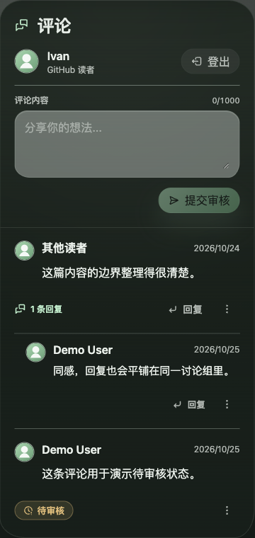

# GitHub 读者登录与公开评论

本文定义 GitHub 读者登录、三类内容的评论与回复、审核、软删除及响应式呈现的长期契约。实现覆盖见 [IMPLEMENTATION.md](./IMPLEMENTATION.md)，兼容背景见 [HISTORY.md](./HISTORY.md)。

## Context and Scope

- Context: 读者需要通过可信 GitHub 身份在公开内容下交流，唯一管理员需要在评论区及后台审核和管理这些内容。
- In scope: 文章、普通与剪藏 Memo、项目详情的评论；GitHub 读者身份与会话；登录回跳与本地草稿；审核、回复、软删除、管理员恢复、后台批量操作与待审核数量；公开站与 Console 的响应式布局；官方路由 Web Demo 验收。
- Out of scope: 管理员认证改造、多管理员、邮箱或游客评论、历史评论认领、读者编辑已提交内容、站内资料编辑、邮件及推送通知、站内消息中心、账户封禁系统、跨设备草稿、GitHub 仓库操作，以及向读者开放私人 AI 对话。
- 本主题拥有评论功能的新行为与布局边界；Nature Spec 继续拥有共享视觉、移动内容流和控件尺寸。剪藏 Memo 在拥有评论区时的宽屏互动区域按本主题组合；剪藏 Spec 继续拥有私人对话权限、阅读材料、生成恢复和窄屏 AI 抽屉。

## Terms and Interfaces

- 领域术语以 [GLOSSARY.md](../../../GLOSSARY.md#公开互动) 为准，包括读者登录、评论对象、主评论、评论回复、历史评论、待审核评论、已通过评论和已删除评论。
- 评论对象由内容类型与该类型内的规范目标标识共同确定；`article`、`memo`、`project` 是独立命名空间。对象可来自发布内容或项目 catalog，不要求项目一定存在 posts 表记录。
- 读者身份来自服务端确认的 GitHub 持久用户 ID；管理员身份来自既有独立认证。管理评论不要求管理员先执行 GitHub 读者登录。
- Interface: 共享公开详情路由、Console 认证与评论 API、评论区管理员操作、`/admin/comments`、后台待审核数量，以及独立构建的 Web Demo。现有 REST、tRPC 和后台入口必须执行一致的权限与状态规则。

## Requirements

### REQ-GRC-001 — 评论范围与内容可见性

- 文章、普通 Memo、剪藏 Memo 和项目详情 MUST 提供评论与回复；列表页不因此增加完整评论区。
- 读取或写入评论前 MUST 验证目标存在且对当前调用者可公开阅读；GitHub 登录不得增加私有内容、草稿、管理界面或私人剪藏对话权限。项目 catalog-only 目标必须可用。
- 三种目标类型之间不得因相同 slug 混用讨论；文章历史评论必须仍归属于原文章。
- 未登录者 MUST 能读取已通过且未删除的评论，不能因此被迫登录。

### REQ-GRC-002 — 读者与管理员身份隔离

- 读者新建主评论和回复 MUST 使用有效的 GitHub 读者会话，服务端与前端同时执行；游客自填作者资料、旧游客会话和普通邮箱登录不得替代 GitHub 读者身份。
- GitHub 身份 MUST NOT 根据邮箱、昵称、GitHub 资料字段或与站长同名获得管理员权限；现有唯一管理员的认证与授权必须保持独立。
- 读者登录、续登、过期和退出 MUST NOT 覆盖、撤销或提权管理员身份，也不能改变私人 AI 对话权限。管理员的审核操作仅依赖既有管理员权限，不依赖读者登录。

### REQ-GRC-003 — 身份与公开资料

- 评论归属 MUST 关联 GitHub 持久用户 ID 所对应的读者身份；同一账号更改 login、昵称或头像不能改变评论归属，不同账号不能因同名合并。
- 公开作者资料 MUST 使用 GitHub 昵称、头像和主页；昵称为空时回退 login，头像失败时使用本地默认头像。资料在成功登录时刷新，本次不增加站内资料编辑页。
- 登录和评论 MUST 允许没有公开邮箱的 GitHub 账号使用，不额外要求填写邮箱，不申请私有邮箱或仓库访问权限；公开评论响应不得包含作者邮箱，包括历史邮箱。

### REQ-GRC-004 — 历史记录与迁移边界

- 历史评论 MUST 保留正文、原作者署名、审核状态、所属文章及回复关系，不按邮箱或昵称自动认领或合并到 GitHub 身份。
- GitHub 读者 MUST NOT 因资料相同读取历史私人审核状态、删除历史评论或继承旧账户权限；历史评论继续由管理员管理。
- 历史 rejected 等状态必须保持原可见性，不因引入新审核流程而自动通过。迁移必须保全原始归属，无法确定的关系不得猜测或静默丢弃。

### REQ-GRC-005 — 登录与草稿体验

- 评论区 MUST 提供当前页跳转 GitHub 的登录入口，成功后返回发起登录的原文章、Memo 或项目评论位置，恢复尚未提交的草稿和回复对象；不得自动发表评论。
- 草稿 MUST 在当前浏览器本地按内容类型、目标与回复上下文区分；不要求跨设备同步，不在登录前上传为服务器草稿。取消、失败及会话过期必须保留文字并提供重试。
- 恢复时若回复对象已删除或失去访问权，MUST 保留文字并提示重新选择目标，不得擅自转为主评论发布。成功提交后才清空相应草稿。
- 读者会话采用七天固定有效期；过期需重新登录，退出必须在服务端失效当前读者会话。登录状态读取失败应说明暂不可用，不得误报退出成功或降低身份要求。

### REQ-GRC-006 — 授权与部署边界

- GitHub 授权 MUST 使用服务端完成的 Web 授权码流程、绑定当前浏览器尝试的一次性 state 与 PKCE S256；错误、过期、重放或不匹配的回调不得创建读者会话。
- 回调、会话与读者 API MUST 归 Console 运行面管理；Cookie 保持 Console host 范围及 HttpOnly，生产使用 HTTPS。公开站通过受信任的直接 API 请求获取身份，不扩大 Cookie 域或放松公开回源去身份边界。
- 回跳 MUST 仅接受配置允许的公开站、Console origin 与合法内容路径；GitHub token、密钥和会话凭据不得进入公开构建产物、URL、草稿、公开响应或日志。获取身份后不需要持有 GitHub token 为评论提供持续访问。
- 生产运行面包含公开站与 Console 两个可信 origin，但 MUST 只使用一个生产 OAuth App 和唯一的精确生产回调 `https://console.ivanli.cc/api/public/reader-auth/github/callback`；回调完成后 MUST 按一次性授权状态返回发起登录的公开站或 Console 页面。缺少有效配置或 GitHub 不可用时显示清楚的不可用/重试状态，保留阅读能力与草稿，不回退游客发言。不得要求访客安装仓库应用或授予仓库权限。

### REQ-GRC-007 — 先审核后公开

- 所有新评论和回复 MUST 先进入待审核，提交成功后仅其发表者本人和管理员可见，并明确标记“待审核”；其他读者仅能看到已通过且未删除的内容。
- 本人判断 MUST 使用稳定读者身份，不得使用同邮箱、同昵称或客户端声明。每条回复必须单独审核，通过父评论不代表通过回复。
- 列表、单条查询、分页、回复数、总数、导出和错误响应 MUST 执行同一可见性规则；不能通过数量或缓存泄露他人的待审核内容。公开数量仅统计已通过且未删除的实际评论，不统计结构占位。
- 提交提示 MUST 为已提交待审核，审核成功提示为已通过；不能出现实际公开却提示待审核，或实际未公开却提示发布成功的矛盾。

### REQ-GRC-008 — 评论区与后台管理

- 管理员 MUST 能在内容详情的评论区和后台单条通过、软删除评论及回复；普通读者不得审核自己或他人。
- 后台 MUST 覆盖三类评论对象及历史评论，提供待审核、已通过、历史状态和已删除的区分，以及按类型/目标定位原内容的能力。
- 后台 MUST 支持显式选择条目后批量通过与批量软删除，准确报告实际成功、跳过和失败结果；混入已删除条目不得使其被通过或恢复，重复请求不得错误增加处理数量。
- 两处管理入口 MUST 读取一致状态，操作成功后刷新相应列表和待审核数量。后台基础交互必须使用 `apps/admin/src/components/ui.tsx` 的本地 primitives。

### REQ-GRC-009 — 读者内容权限

- 读者 MUST NOT 修改任何已提交的主评论或回复，无论待审核或已通过；前端不得提供编辑入口，所有服务端编辑入口必须拒绝读者请求。
- 读者 MUST 能软删除本人通过 GitHub 身份发表的待审核或已通过内容，不能删除他人或历史评论；归属与目标可见性必须在服务端校验。

### REQ-GRC-010 — 软删除与讨论连续性

- 读者自删、管理员评论区删除、后台单条或批量删除 MUST 统一采用软删除，保留原记录、原内容及回复关系，不级联删除其他回复。
- 正常评论区与读者接口 MUST 不再返回已删除正文和作者昵称、头像、主页；存在当前调用者可见的回复时仅以“该评论已删除”维持结构，无可见回复时不产生列表条目。
- 回复所指对象已删除时，MUST 不再通过回复标签、引用、计数或嵌套对象回传其正文与作者资料。未公开的待审内容不得因为被删除而向其他读者产生新的公开占位。
- 删除状态 MUST 独立于审核状态；迟到的单条或批量通过不能使已删除内容重新出现，重复删除保持一致结果。

### REQ-GRC-011 — 已删除查看与恢复

- 仅管理员 MUST 能在后台已删除筛选中查看原记录、原内容并执行单条恢复；读者不得查看已删除原文或自行恢复。
- 恢复 MUST 保留原正文、对象及回复关系，统一回到待审核；必须再次明确通过才公开，不连带恢复其他已删除记录。
- 普通通过 MUST NOT 替代恢复，恢复也不得被解释为直接公开；恢复后的可见性必须继续满足待审核规则。

### REQ-GRC-012 — 回复关系与两层呈现

- 回复 MUST 采用主评论加同层回复的最多两层展示，允许继续互相回复并标明回应对象；多轮交流不得继续缩进，也不得因超过现有两层读取而丢失已提交回复。
- 新回复 MUST 只面向同一对象、同一讨论组中已通过且未删除的具体评论，不能向不存在、待审核或其他内容的评论 ID 写入；待审评论不开放继续回复。
- 主评论软删除后，MUST 保留已有回复和讨论归属，仍可回复其中已通过且未删除的具体回复；不能通过此操作恢复主评论正文。恢复主评论但尚未重新通过时，其他读者只能看到必要的匿名结构占位及其本来可见的回复。

### REQ-GRC-013 — 响应式评论区域

- 三类详情 MUST 共用以下布局边界；正文、链接、目录及阅读顺序不能因新增评论而丢失，不能出现页面横向溢出。

| 视口宽度 | 评论位置与承载 |
| --- | --- |
| 至少 1280px | 正文右侧，优先 320–360px 互动栏，正文保持可读宽度；复用宽内容容器，不新增第三列挤压阅读。 |
| 640–1279px | 正文之后的独立评论卡片；项目链接与目录即使在窄布局前置，评论仍必须位于正文之后。 |
| 小于 640px | 正文之后的连续阅读承载层，去掉评论区结构性卡片边框、圆角和阴影；控件保留必要边界和触控面积。 |

- 公开控件 MUST 继承 Nature 的桌面 36px/32px 与其他情形至少 44px 目标、主题、对比度及减少动态约定。评论不能在正文、右侧或 AI 区域被重复挂载造成双提交或两份状态。

### REQ-GRC-014 — AI 对话与既有侧栏

- Console 宽屏剪藏详情中，当评论与 AI 对话争用右侧区域时 MUST 使用“评论 / AI 对话”tabs；默认评论，仅向原本有 AI 权限的身份提供 AI tab，不为普通 GitHub 读者请求私人会话数据。
- tabs 与响应式切换 MUST 保留评论草稿、AI 草稿、消息、生成状态和必要滚动上下文，不重复发起生成；必须支持键盘、可访问名称、选中状态及焦点管理。
- 非宽屏评论 MUST 保持正文下方的位置；AI 延续其既有独立交互及窄屏底部抽屉，评论不得被收进私人对话抽屉。项目公开入口与目录继续保留，宽屏与评论共享右侧空间，非宽屏不得携带评论一起前置。

### REQ-GRC-015 — API、缓存与运行面

- 评论正文、状态、删除和本人归属 MUST 由服务端验证；REST、tRPC、评论区及后台接口不能出现可绕过身份、审核、编辑限制或软删除的旁路。
- 个性化评论结果与身份结果 MUST 不经共享缓存复用；静态页面、快照和 Web Demo 的导出不得包含待审、已删除原文、私人 AI 数据、凭据或其他读者的私人状态。
- 管理员在 Console 已有认证下 MUST 能执行评论区管理；公开站静态页面与回源 HTML 不得因为这些运行时操作带入管理员身份或私有内容。

### REQ-GRC-016 — 提交、加载与基础防滥用

- 评论与回复 MUST 拒绝空白内容，沿用最多 1000 字的长度边界和安全 Markdown 展示，防止脚本及危险 URL。GitHub 读者发言不再依赖游客表单的人机验证脚本。
- 提交中 MUST 阻止重复操作，并使同一次提交的重试不重复落库；失败保留正文，服务端须有按读者身份执行的有界频率限制及清楚的重试反馈。
- 主评论 MUST 沿用时间先后顺序、每批 10 条的分页体验，回复加载必须有界；长讨论仍可完整读取，不能以无限挂载或全部返回代替分页。

### REQ-GRC-017 — 通知范围

- 后台 MUST 提供真实待审核数量及集中处理入口；已软删除记录不计入待审核数量，恢复为待审核后重新计入。
- 本功能 MUST NOT 增加邮件通知、浏览器推送、站内消息中心，或为了通知额外采集读者邮箱。

### REQ-GRC-018 — 演示与验收表面

- 页面验收 MUST 使用三类产品详情的官方路由及其独立构建 Web Demo，不新增复制页面、页面级 Story 或可由运行时开关启用的 live Demo。
- Web Demo MUST 使用共享 Inspector，覆盖访客、作者、其他读者、管理员、网络失败、延迟、审核、软删除、恢复、长讨论及三档布局；模拟操作须形成可检查的内存变更，可重置与共享场景。
- 演示 MUST 不请求真实 GitHub 授权或私人 AI 服务；模拟成功不能替代真实授权回调和生产运行面权限验收。

## Verification

### VER-GRC-001 — 内容对象与身份

- Method: 同名 article/Memo/catalog-only project、私有与草稿内容、缺失目标、稳定 GitHub ID 改名、旧邮箱用户、管理员及未登录者的 API 与路由组合检查。
- covers: `REQ-GRC-001`, `REQ-GRC-002`, `REQ-GRC-003`, `REQ-GRC-004`
- Pass condition: 三类详情正确归属且不串评论；改名不改归属，无邮箱也可登录；旧身份不能认领或删除，普通读者不能提权或读取私有内容，公开响应无作者邮箱；历史署名、状态和关系保全。

### VER-GRC-002 — 授权、回跳与会话

- Method: 可控授权提供方覆盖成功、拒绝、失败、错误 state、PKCE 失败、重放、恶意回跳、过期和退出，并在实际部署的公开站与 Console 验证合法回调及会话读回。
- covers: `REQ-GRC-005`, `REQ-GRC-006`
- Pass condition: 返回原评论位置和草稿且不自动发言；所有无效回调都不建会话，凭据不进入公开产物或 URL；七天后需重登，退出使当前读者会话失效且管理员身份保持；未配置时不回退游客写入。

### VER-GRC-003 — 审核可见性与双入口

- Method: 作者、其他 GitHub 读者、访客和管理员交叉读取待审/已通过/历史状态，分别从评论区和后台操作单条与混合批次，并检查列表、数量、分页、导出和缓存。
- covers: `REQ-GRC-007`, `REQ-GRC-008`, `REQ-GRC-015`, `REQ-GRC-017`
- Pass condition: 待审仅本人和管理员可见，逐条通过才公开，前后端操作与数量一致；批量结果准确，已删除项不会被批量通过；待审与私人信息不能经缓存或旁路泄露；仅后台有待审提示，没有额外通知系统。

### VER-GRC-004 — 不可编辑、软删除与恢复

- Method: 对本人、他人、历史评论和待审/已通过记录执行前端与直接 API 修改、删除、恢复及删除/通过并发，包含含回复主评论与被回复对象。
- covers: `REQ-GRC-009`, `REQ-GRC-010`, `REQ-GRC-011`
- Pass condition: 读者修改全部拒绝，仅能软删除本人新内容；数据库记录及回复保留，普通接口和回复标签无已删除正文/作者资料；只有管理员后台可查看和恢复，恢复待审，再通过才公开，迟到通过不会复活删除内容。

### VER-GRC-005 — 回复、输入与重试

- Method: 多轮互相回复、同 slug 跨类型、伪造父 ID、待审/已删除目标、已删除主评论、空白/超长/危险 Markdown、重复提交、失败重试及多页长讨论。
- covers: `REQ-GRC-012`, `REQ-GRC-016`
- Pass condition: 多轮交流完整呈现且最多两层；只有同讨论组合法目标可回复；主评论删除不丢回复，标签不泄露删除资料；输入与频率限制有效，同次重试仅一条记录，加载有界且所有可见内容仍可访问。

### VER-GRC-006 — 布局、tabs 与演示

- Method: 三类官方详情在 320、393、639、640、1024、1279、1280、1440、1920px 下的可控浏览器证据及键盘检查，组合 light/dark、长文本、作者待审、管理员与私人 AI 生成状态，并检查独立 Demo 产物。
- covers: `REQ-GRC-013`, `REQ-GRC-014`, `REQ-GRC-018`
- Pass condition: 三档位置正确，窄屏无外层卡片，项目目录/链接保留且评论不前置；AI 权限独立，tabs/断点切换不丢草稿或生成状态；Inspector 模拟操作持久于当前内存场景，live 无 Demo 旁路，不出现重复评论组件或横向页面溢出。

## Visual Evidence

证据源为构建时隔离、fixture 驱动的正式路由 Web Demo；评论片段使用官方文章路由与 Console Memo 路由，桌面截图为 1280×900 与 1440×1000，窄屏截图为 639×900 CSS px。浏览器验证确认公共读者与管理员分别显示正确的登录/管理能力，Console 管理员只挂载一个评论区，窄屏评论区去除结构性卡片阴影；主人已确认当前界面符合预期，页面级 Storybook 证据不适用。

## Related ADRs

- [移动公开内容流](../../adr/0003-public-mobile-content-stream.md)
- [静态公开站与自包含 Console](../../adr/0010-self-contained-console-runtime.md)
- [剪藏阅读与私人对话边界](../../adr/0012-memo-clipping-content-boundaries.md)
- [构建时 Web Demo 与 Story 边界](../../adr/0013-build-time-web-demo-and-story-boundary.md)
- [Memo 详情与作者预览边界](../../adr/0024-memo-detail-preview-boundary.md)
- [GitHub 读者与历史评论身份隔离](../../adr/0029-github-reader-and-legacy-comment-identity.md)

## References

- [需求设计与细节复核](../../github-login-comments-design.md)
- [实现覆盖](./IMPLEMENTATION.md)
- [兼容背景](./HISTORY.md)
- [GitHub Web application flow](https://docs.github.com/en/apps/oauth-apps/building-oauth-apps/authorizing-oauth-apps#web-application-flow)
- [GitHub scopes](https://docs.github.com/en/apps/oauth-apps/building-oauth-apps/scopes-for-oauth-apps#available-scopes)
- [GitHub durable user ID](https://docs.github.com/en/rest/users/users#get-a-user-using-their-id)
