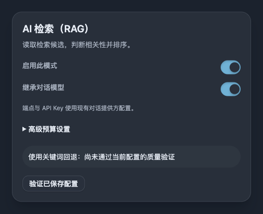

# 三种搜索模式与可靠关键词回退

> 本文件定义长期搜索契约；实现方案与覆盖状态记录在 `IMPLEMENTATION.md`，兼容关系记录在 `HISTORY.md`。

## Context and Scope

站内搜索提供一个“智能搜索”三选一控件：关闭、LLM + RAG、LLM 查询改写。未指定时默认关闭智能搜索，由关键词全文检索快速返回基础结果；选择任一 AI 模式时，AI 补充与基础结果统一参与相关性排序，同时保护合法关键词命中不被删除。两种 AI 模式独立执行，不互相串联或接管故障；任一不可用时，以用户原始查询直接回退到关键词搜索。三者都返回实际站内内容列表，不生成问答。原始关键词命中不能被模型删除，结果数量不要求填满，内部排名值不作为可信百分比。三种模式共用内嵌 Tantivy 全文检索。

- In scope: 公共搜索页面、公共 HTTP、tRPC 与 MCP 中的模式选择、文章与 Memo 搜索、结果排序与截断、回退和搜索元信息。
- Out of scope: 生成式问答、内容发布权限的改变、文章与 Memo 列表的既有排序、Playbook 发布及章节索引的替换。

## Terms and Interfaces

- 领域术语使用 [GLOSSARY.md](../../../GLOSSARY.md) 中的 RAG 搜索、查询改写搜索、关键词搜索、搜索回退和关键词命中保全。
- 模式标识为 `rag`、`rewrite`、`keyword`；搜索模式与查询语法分类是两个独立维度。
- 关键词命中是符合受控查询含义的内容；不把查询词自动改成内容类型筛选条件。
- RAG 的语义补充是没有进入原始关键词集合、但通过有效上下文判断的内容；改写补充只满足受控改写查询，不声称经过内容语义判断。
- 返回上限限制唯一内容搜索结果的数量，不表示索引命中总量，也不要求填满。
- `/api/public/search` 的数组响应及公开权限继承 [搜索语法与全文回退契约](../search-full-text-fallback/SPEC.md)。
- 各入口共用三种模式，已有 enhanced 兼容入口路由到 RAG；独立 semantic 仍表示显式底层语义检索，不是页面中的第四种模式。

| 页面名称 | 模式 | LLM 能读取的信息 | 结果排序 | AI 不可用时 |
| --- | --- | --- | --- | --- |
| RAG | `rag` | 查询与已检索、已授权的有界候选上下文 | 关键词命中保全，与 LLM 判断后的补充统一按相关性排序 | 原始查询的关键词搜索 |
| AI 改写 | `rewrite` | 查询与静态策略，不能读取站内内容或检索反馈 | 全文引擎排名的融合，保全原始关键词命中 | 原始查询的关键词搜索 |
| 全文检索 | `keyword`，默认 | 不调用 LLM | 全文引擎排名 | 全文引擎不可用时受控报错 |

## Requirements

### REQ-SREL-001 — 关键词命中保全与统一排序

两种 AI 模式必须独立取得用户原始查询的合法关键词集合，再与有效补充统一排序。当关键词命中不超过返回上限时，所有合法命中必须进入结果，不得因为模型改写、不在向量候选中、缺少向量、重排低分或推测语境不同而遗漏。命中超过上限时，先按关键词相关性与稳定同分顺序确定返回范围；模型可以在候选集合内改变排序，但不能换入范围外内容或删除合法关键词命中，补充不得挤掉受保护的关键词容量。不能通过对混合结果直接截取前 N 条实现保全。

单独搜索 `Node` 时，包含 `Node.js` 的内容属于实际文字命中，不得因其 JavaScript 运行时含义而被排除；上下文判断可以影响排序，不能取消命中。只在参考链接中提到 SQLite 的内容必须保留，但真正介绍 SQLite3 的可信语义内容可以排在它前面。

### REQ-SREL-002 — 有效补充与数量上限

RAG 补充必须通过有效上下文判断，不得把向量前 N 名、本批最高分或每批归一化分数视为相关性证明；未判断候选不返回。改写补充必须实际满足有效受控改写查询，不能由 LLM 编造文档、链接或排名。两者按内容身份去重后应用上限；实际有效内容只有少量时只返回这些内容，完全无关输入允许无结果。

### REQ-SREL-003 — 明确查询含义

普通空白分隔多词采用 AND；支持引号短语、`slug:`/`title:`/`excerpt:`/`body:`/`tags:` 字段、AND/OR/二元 NOT、括号及词或短语末尾的显式 `*`。NOT/AND 优先于 OR，括号改变优先级，引号中的操作词仍是文字。引号、字段、布尔条件、括号、前缀与非法高级语法的文字重试直接执行关键词搜索，不进行模型改写、名称扩展或语义补充。空白查询返回空列表且不调用 AI；`文章` 是检索文字，不能被模型解释为内容类型筛选。

新三种模式及 enhanced 入口不支持未加引号的 `NEAR(...)` 位置语法，包括能辨认出该语法意图的损坏写法；返回受控 `unsupported-query`，不得静默转成文字或改变距离含义。普通文字 `NEAR` 与引号内的 `"NEAR(alpha beta, 3)"` 可以按文字检索。其他非法高级语法继续按文字项 AND 重试；预算超限直接拒绝，不进入文字重试。独立 semantic 与内容列表保留旧主题的共享解析器、SQLite NEAR 和既有查询行为。

### REQ-SREL-004 — 真实结果元信息

公开搜索结果不得展示“相关度 XX%”或把内部排序值表达为可信概率。内容类型、摘要与原文命中高亮保留；语义和改写补充不得假造原始查询命中。可以高亮原文实际存在的有效别名或改写词，但不能伪装成原始拼写；可访问元信息同样准确。高亮不改变原文、空白、代码缩进或布局。关键词、回退、明确语法及受控错误的空态推荐词只能走确定性来源，不自动发起旁路 AI 请求或恢复旧 AI 推荐缓存。

### REQ-SREL-005 — 内容与接口边界

公开权限、私有与草稿排除、剪藏可见性、无标题 Memo 展示和规范 URL 必须生效。检索及模型上下文只能包含当前调用者可访问内容，返回前再次校验身份与可见性。跨类型同 slug 不合并。公开 HTTP 兼容 JSON 数组，模式状态通过独立响应元信息提供，不要求修改已有结果对象；提供方错误及密钥不对读者公开。

### REQ-SREL-006 — Playbook 来源边界

Playbook 继续使用页面绑定的公开 edition、确定性搜索和章节聚合，不进入文章与 Memo 的 AI 链；模式切换只影响相应内容来源。保留各来源顺序、独立上限、唯一内容计数及既有单一连续列表，不直接比较跨来源原始分数。

### REQ-SREL-007 — AI 不可用时直接关键词回退

所选 AI 模式关闭、未配置、依赖不可用、超时、输出无效、预算不足或质量策略未通过验证时，直接以用户原始查询执行关键词搜索。不转入另一 AI 模式，不使用失败前的改写查询回退，也不放行未经判断的向量结果。正常无结果不是不可用，不触发换模式；关键词引擎故障为受控错误，不伪装为成功空结果。

### REQ-SREL-008 — 模式入口一致

公共 HTTP、tRPC 与 MCP 共用三种模式、命中保全、质量与回退规则，新调用者可明确指定模式；未指定模式统一默认 `keyword`。已有 enhanced 入口兼容路由到 RAG，`rerank=false` 使用关键词，不能成为绕过判断的开关。显式模式与冲突的旧参数不能被静默解释；旧嵌入模型参数仍只表示 embedding，不能改成 chat 模型，无法继续支持的旧 rerank 模型覆盖返回受控迁移错误。

各入口尊重其已有返回上限；新模式不借兼容入口扩大扫描或权限。公共 HTTP 保留数组响应，模式元信息包含所选模式、实际模式和受控执行原因；新模式 API 明确返回同等元信息，旧 enhanced 保持数组结构。独立 semantic 保留显式底层语义检索及既有权限、类型、预算和嵌入故障回退，不作为页面的第四个选项；MCP 非公开访问继续要求管理员授权。

### REQ-SREL-009 — 技术名称与文字片段的匹配准确性

三种模式共用的普通名称匹配必须避免错误子串命中：`Arch` 命中 `Arch Linux`、`Arch-Linux` 与 `中文Arch中文`，不得因包含相同字符而把 `archive`、`search`、`aarch64`、`ArchLinux` 或 `arch_linux` 算作关键词命中。中文支持连续文字片段，如 `文章` 可以命中 `这篇文章`，不得命中 `文隔开章`、`文。章`、`文 章` 或 `文-章`。英文技术名称匹配忽略 ASCII 大小写；名称边缘的 ASCII 字母、数字、下划线、加号和井号属于延续，点号、连字符、斜杠及中英交界可以构成边界。`Node` 可以命中 `Node.js`，`ESP32` 可以命中 `ESP32-C3`；`SQLite` 不字面命中 `SQLite3`，`C++` 不字面命中 `C++17`。版本扩展可使用显式前缀、有效受控改写或 RAG 补充，不能冒充原始文字命中。

技术名称中的标点必须按输入保留：`C`、`C++`、`C#` 不得混同，`Node js` 不得作为 `Node.js` 的实际文字命中。匹配、查询正规化与高亮不得改变已显示的原文；中文片段不附加英文名称的外侧限制，中英混排按输入边缘分别判断。查询端继续使用既有 NFKC 正规化；本主题不新增文档端全角、重音或其他 Unicode 拼写等价规则。

需要英文词首匹配时使用显式前缀语法，如 `arch*` 可以命中 `architecture`，但不得命中 `search` 或 `aarch64` 中间的文字；`sqlite*`、`C++*` 可用于版本名称。匹配规则必须用实际内容验证，不能以“英文完整词”这一名称替代技术符号、中英混排、分隔符和原文位置的明确处理；采用某个 tokenizer 或新增索引本身不构成准确性证明。字段作用域、布尔组合与非法语法文字重试按受控解释执行，NEAR 的不支持行为按 `REQ-SREL-003`。原始子串候选必须在应用结果上限之前完成有效命中校验，不得先取前 N 条再过滤而遗漏有效命中。

### REQ-SREL-010 — 两种 AI 各自的质量依据

RAG 的内容判断与查询改写分别使用与有效模型、提示词、输入及输出策略匹配的验证依据，不互相借用结果。RAG 覆盖同义概念、正文相关性及无关候选；改写覆盖有效转换、无关输入、过度放宽和名称混淆。模型自报置信度、每批分数拉伸和 mock 测试不能替代实际模型验证；没有匹配依据时回退关键词。模型或策略变化后重新验证，不能用全部拒绝来声称正例通过。

### REQ-SREL-011 — 新策略与缓存隔离

新策略隔离旧服务端 AI 缓存及旧浏览器结果缓存。AI 缓存区分模式、查询含义、权限、模型、提示词、质量策略与输入身份；每次执行取得当前原始关键词集合，返回前校验权限，不能通过最终结果缓存绕过这些步骤。失败与关键词结果不进入 AI 结果缓存；浏览器恢复结果不能让另一模式或较旧请求覆盖当前选择。Playbook edition 缓存保留。

### REQ-SREL-012 — 有界处理与稳定排序

查询解析、候选检索、正文上下文、模型请求和结果数量都有明确预算，不全量载入正文交给模型，不以静默截断冒充完整执行。解析保留最多 2,048 个 Unicode 码点、128 个词法 token、32 层 AST 的既有硬界限，新的引擎编译成本另有硬上限；旧 SQLite 的 256 SQL 参数预算不能被误称为 Tantivy 查询预算。RAG 整体输入不足以可靠判断时回退关键词，个别未判断候选不返回；查询改写只生成有限受控查询，不执行任意 SQL、引擎 DSL、工具循环或扩大权限范围。名称校验先于排序和显示截断，同分采用稳定的时间与内容身份顺序。

### REQ-SREL-013 — 名称别名与多义简称

普通查询必须支持已确认的名称别名组，`NodeJS`、`Node.js` 与表示 JavaScript 运行时的 `Node` 可以互查。确定别名 `NodeJS` 与 `Node.js` 双向形成关键词命中，语义能力不可用时仍有效；搜索 `Node` 时，`Node.js` 通过实际文字命中、`NodeJS` 通过确定目标名称的别名命中进入关键词集合。

搜索 `NodeJS` 或 `Node.js` 扩展到只有 `Node` 拼写的内容，需要 RAG 确认其 JavaScript 运行时上下文；不要求正文另含完整名称，也不放行只有图或集群节点含义的内容。关键词和查询改写模式不无条件扩展到多义简称，模型改写不能通过生成 `Node` 绕过该边界。判断不可用时跳过补充；这个限制不反向取消原始查询成立的文字命中。

别名必须来自明确核对的映射，不得通过删除标点、截取英文前缀或猜测技术词自动产生。别名扩展保持普通多词 AND 的条件结构；引号、字段、布尔表达式、显式前缀及非法高级语法的文字重试不自动扩展名称别名。展示只高亮内容中实际存在并成立的拼写，不能将别名伪装成原文已有的查询拼写。

### REQ-SREL-014 — 三种独立执行链

`rag` 先检索可访问候选，再让 LLM 阅读上下文、判断相关性并排序；`rewrite` 只让 LLM 理解或改写查询，之后由全文引擎执行与排序，LLM 不接收站内目录、候选摘要、正文或检索反馈；`keyword` 直接执行原始查询的确定性全文搜索。三种模式均返回真实内容列表，不生成问答。

两种 AI 模式可以共享全文引擎、权限及底层模型提供方，但各自拥有策略、缓存、预算和可用性判断。RAG 不调用改写模式，改写不依赖向量、嵌入、RAG 索引或内容重排；一条链的故障不能错误标记另一条链不可用。

### REQ-SREL-015 — 手动选择与实际模式

页面提供“智能搜索”三选一控件：关闭、RAG、AI 改写，并说明两种 AI 补充方式的差别。未指定时默认关闭智能搜索（`keyword`），URL 中的显式有效模式始终优先，非法模式值返回受控输入错误。切换后以同一原始查询重新执行；查询、所选模式及已有筛选可以通过 URL 表达，刷新、分享与前进后退保留选择，旧请求及缓存不能覆盖新选择。

回退时明确说明当前结果使用关键词搜索，保留用户选择，下次请求仍可尝试该模式；不永久改选或自动轮询。高级语法直接关键词执行时，同样如实表示实际模式。加载、无结果、筛选后为空、AI 回退和全文引擎故障是可区分状态，不将错误显示为空结果。控件、键盘操作、触控目标、明暗主题、移动结果流及首屏信息密度遵循共享公开 UI 契约。

### REQ-SREL-016 — 内嵌成熟全文引擎

三种模式及 enhanced 入口的文章与 Memo 全文检索采用内嵌 Tantivy 磁盘索引，由 Bun 的受控原生接入层调用，不要求部署独立搜索服务。引擎负责倒排索引、查询执行及全文相关性排名；项目仅负责规则配置、受控查询编译、权限、同步与编排，不自写通用分词器或全文评分引擎，也不以全量正文后过滤弥补名称错误。

支持的发布平台必须有可加载的原生发行物，实际发布镜像必须通过加载与异步查询验证；原生调用不能阻塞 Bun 的服务事件循环。锁定依赖、构建、收集原生文件及开发平台的接入方式属于可复现项目资产，不能依赖机器上临时编译的产物。独立 semantic、列表的 SQLite 索引及 Playbook 引擎保留各自职责。

### REQ-SREL-017 — 可重建索引与当前内容一致性

Tantivy 索引是可重建投影，不替代现有文件内容与 SQLite 的存储责任。路径必须隔离开发、测试及生产，索引 schema、分析器及别名策略的版本可辨认；writer 的所属进程明确，同一索引不能被多个 writer 并发写入。新增、修改、删除、改名、类型、标签及可见性变化覆盖所有内容写入入口，数据库事务回滚不发布索引变更，重放幂等，崩溃后可以恢复。

请求以开始时的内容版本为一致性基线，全文快照达到对应变更水位后才可返回成功；等待有硬预算，未准备就绪、提交失败、坏索引或版本不兼容为受控不可用状态，不能用旧结果或空列表冒充当前关键词命中。候选进入 LLM 和最终返回前仍校验当前权限与版本，撤回公开内容不得泄漏；不向模型发送已过时正文。索引检查、显式重建及版本更换的安全切换可执行且可验证，不在每次请求中触发无界重建。

### REQ-SREL-018 — 独立配置与有效可用性

两种 AI 模式分别拥有启用状态、模型配置引用、提示词与输出策略、时间与 token 预算、质量依据及缓存身份；允许引用同一现有 chat 提供方，不要求额外购买或配置不同模型。RAG 另外依赖 embedding 和向量状态，改写及关键词不依赖它们；既有 rerank 提供方不能自动当作候选内容判断用的 chat 模型。未验证的配置不能静默启用 AI 补充。

模型、有效端点、凭据、提示词、名称策略或质量依据变化使受影响模式的旧可用性结论与缓存失效；一条链的失效不污染另一条链。调用者只收到受控状态，运维可定位实际模式、回退原因和各阶段成本，日志不包含密钥或未经授权的内容。

## Verification

管理员在现有模型管理页分别管理 RAG 与改写的启停、继承 chat 或覆盖模型及有界高级预算。策略独立持久化，复用现有提供方与密钥；仅已保存配置可异步执行固定合成样例的质量验证，显示进度与失败原因。配置改变使旧任务结果及质量依据失效，非管理员不得读写策略或启动验证。接口为 GET/PUT `/api/admin/search-settings`、POST `/api/admin/search-settings/validate` 和 GET `/api/admin/search-settings/validation/:runId`。

### VER-SREL-001 — 命中保全与截断

- Method: 使用正文命中、标签命中、无向量命中、低模型判断及跨类型同 slug 的固定集合，比较三种模式与原始关键词集合；覆盖命中数少于、等于、超过上限，以及改写不再包含原词的情况。
- covers: `REQ-SREL-001`, `REQ-SREL-002`, `REQ-SREL-005`
- Pass condition: 显示范围内的关键词命中没有遗漏；可信语义内容可以按相关性排在仅顺带提及关键词的内容前面，后者仍保留。候选去重、稳定同分顺序与最终数量正确。

### VER-SREL-002 — 弱相关与概念发现

- Method: 使用同义正例、完全无关输入、全候选不相关、缺少判断或原文依据、虚构候选 ID，以及实际改写命中与过度扩展的固定场景，检查集合与排序。
- covers: `REQ-SREL-002`
- Pass condition: 有效补充可以返回，无关场景允许为空；RAG 不放行未判断或虚构候选，改写结果实际满足受控表达，不以相对排名当相关性证明。

### VER-SREL-003 — 查询解释

- Method: 覆盖普通多词 AND、引号内操作词、短中文字段过滤、OR/NOT/括号、前缀、NEAR、非法文字重试、只有语法符号及预算超限输入。
- covers: `REQ-SREL-003`
- Pass condition: 默认搜索的关键词集合符合受控查询解释；明确语法与文字重试不会被语义结果稀释。新模式及 enhanced 的 NEAR 位置语法明确拒绝，引号内和普通 NEAR 文字可检索；旧列表和独立 semantic 的 NEAR 行为保持。空白查询无 AI 调用，预算超限受控拒绝。

### VER-SREL-004 — 展示与可访问语义

- Method: 在公开 Web Demo 的正式搜索路由检查普通命中、无字面语义补充、空结果和类型筛选状态；记录关键词、回退、明确语法和错误空态的建议请求，覆盖旧 AI 建议缓存和延迟响应、桌面及共享契约要求的移动宽度与明暗主题。
- covers: `REQ-SREL-004`, `REQ-SREL-005`
- Pass condition: 不出现相关度百分比；类型、摘要、可访问名称和真实高亮准确，布局、文字与复制内容遵循既有契约。确定性空态不发起 AI 建议或恢复旧 AI 建议，延迟建议不覆盖当前模式。

### VER-SREL-005 — 多来源内容

- Method: 使用包含文章、Memo、剪藏和 Playbook 多章节命中的固定集合，检查来源顺序、独立上限、绑定 edition、展开收起和类型计数。
- covers: `REQ-SREL-005`, `REQ-SREL-006`
- Pass condition: 不比较跨来源分数、不改变来源输入顺序，不混用 edition，不重复计算章节或跨类型合并内容。

### VER-SREL-006 — AI 不可用与关键词回退

- Method: 分别注入两种 AI 的关闭、配置缺失、超时、无效输出、预算不足和未验证策略，以及 RAG 的嵌入与向量故障；区分正常空结果和关键词引擎故障。
- covers: `REQ-SREL-002`, `REQ-SREL-007`
- Pass condition: 仅以原始查询回退关键词，无另一 AI 调用；正常空结果不换模式，关键词引擎故障为受控错误。

### VER-SREL-007 — 入口与显式语义检索

- Method: 对同一查询、权限及模式比较 HTTP、tRPC 与 MCP，覆盖默认行为、enhanced 兼容参数、不同上限、显式 semantic 及 MCP 非公开访问。
- covers: `REQ-SREL-005`, `REQ-SREL-007`, `REQ-SREL-008`
- Pass condition: 增强入口使用同一规则并尊重调用范围；显式 semantic 保持其独立含义，匿名调用不能读取非公开内容。

### VER-SREL-008 — 文字边界

- Method: 固定 `Arch Linux`、`Arch-Linux`、`archive`、`search`、`aarch64`、`ArchLinux`、`arch_linux`、`architecture`、`这篇文章`、`文隔开章`、`文。章`、`文 章`、`文-章`、`Node.js`、`Node js`、`C++`、`C#`、`C++17`、`SQLite3`、`ESP32-C3` 与中英混排场景；分别检查普通词、引号、字段、前缀及布尔组合，并构造首处为非法子串但后处有效、高分子串候选占满初始范围和字符串首尾命中的情形。
- covers: `REQ-SREL-001`, `REQ-SREL-003`, `REQ-SREL-009`
- Pass condition: 完整词、连续中文片段、短语和显式词首语义成立；非法子串候选不会抢占合法结果，技术符号和原文展示准确。

### VER-SREL-009 — 模型质量与评分边界

- Method: 分别用 RAG 判断模型与改写模型评估独立标注正负样本，覆盖中文短词、技术名称、同义表达、正文相关性、过度改写及无关输入；记录有效配置、输入输出策略、误召回与漏召回，切换模型和提示词。
- covers: `REQ-SREL-002`, `REQ-SREL-007`, `REQ-SREL-010`
- Pass condition: 两条链各自通过正负样本，不以全拒绝通过正例；策略不匹配时回退关键词，模型自报概率及本批分数拉伸不充当质量证据。

### VER-SREL-010 — 缓存与资源边界

- Method: 在旧服务端缓存和旧 sessionStorage 存在时切换新策略；覆盖模型、输入与准入策略变化、内容及可见性变化、短中文高频查询、大量子串候选和 10,000 行向量边界。
- covers: `REQ-SREL-005`, `REQ-SREL-011`, `REQ-SREL-012`
- Pass condition: 旧策略或不匹配缓存不被采用，权限和关键词结果及时有效；有效关键词不因预截断遗漏，没有无界正文载入或绕过既有预算。

### VER-SREL-011 — 名称互查与语境边界

- Method: 在三种模式及回退时，用分别只有 NodeJS、Node.js、运行时 Node、图节点 Node 和集群节点 Node 的内容逐一查询；覆盖改写试图生成多义 Node、低判断及高级语法。
- covers: `REQ-SREL-001`, `REQ-SREL-003`, `REQ-SREL-004`, `REQ-SREL-007`, `REQ-SREL-009`, `REQ-SREL-013`
- Pass condition: 搜索 Node 时 Node.js 和 NodeJS 不因推测语境或低模型判断被删除；确定别名在关键词及回退时互查成立。搜索 NodeJS/Node.js 时，只有 Node 的运行时内容可由 RAG 判断后补充，其他节点被拒绝；关键词和改写不无条件扩展 Node。明确语法不扩展别名，高亮保留实际拼写。

### VER-SREL-012 — 执行链独立

- Method: 记录各模式依赖调用；使 RAG 向量或判断失效后验证改写，使改写策略失效后验证 RAG。
- covers: `REQ-SREL-007`, `REQ-SREL-014`
- Pass condition: 两者不调用对方，故障独立；改写模型只接收查询和静态策略，没有内容目录或检索反馈；三者只返回内容列表。

### VER-SREL-013 — 选择与回退状态

- Method: 切换、刷新和分享模式 URL，在旧请求延迟时再次切换；检查回退及高级语法后的下一次普通查询，在桌面和共享契约要求的移动宽度检查控件。
- covers: `REQ-SREL-008`, `REQ-SREL-011`, `REQ-SREL-015`
- Pass condition: 默认关闭智能搜索（关键词全文检索），有效 URL 选择优先，非法模式受控提示；原始查询按选择重搜，关键词命中被保全并与 AI 补充统一排序，旧结果不覆盖新选择。刷新、分享与历史导航可还原状态，实际模式准确，回退不永久改选，触控及键盘操作成立，空结果和错误可区分。

### VER-SREL-014 — 原生发行物与引擎职责

- Method: 在实际发布镜像及受支持开发平台加载打包产物，执行磁盘检索、异步并发与定时器探针；检查分析器配置、受控 AST 编译和全文调用边界，记录完整代表性内容集的索引大小、内存和阶段延迟。
- covers: `REQ-SREL-009`, `REQ-SREL-012`, `REQ-SREL-016`
- Pass condition: 无额外搜索服务即可运行，原生文件随发行物分发且可复现；支持的查询规则由引擎在截断前执行，事件循环可推进，没有自写倒排索引、全文评分或全量正文后过滤，代表性成本有实测依据。

### VER-SREL-015 — 索引变更、恢复与可见性

- Method: 从文件同步、路由、MCP 和批量恢复分别变更内容，覆盖新增、编辑、删除、改名、类型、标签、发布和撤回；注入事务回滚、writer 冲突、提交失败、提交前及 checkpoint 前退出、索引滞后、版本不符和重建切换。检查请求水位及候选判断前和返回前的当前权限。
- covers: `REQ-SREL-001`, `REQ-SREL-005`, `REQ-SREL-007`, `REQ-SREL-017`
- Pass condition: 重放与重建得到相同当前可访问集合，无重复、丢失或撤回内容泄漏；不可用状态明确报错而非返回旧快照或空列表，等待有界，开发、测试及生产索引互不污染。

### VER-SREL-016 — 配置与可用性隔离

- Method: 共用及分别配置 chat 提供方，切换各模式启用、模型、端点、凭据、提示词、预算与质量策略；撤销 RAG 的 embedding 配置，检查改写和关键词仍可执行，检查缓存与运维状态。
- covers: `REQ-SREL-007`, `REQ-SREL-010`, `REQ-SREL-011`, `REQ-SREL-014`, `REQ-SREL-018`
- Pass condition: 每条 AI 链依据自己的有效配置决定可用性并直接回退关键词；chat 与 rerank 角色不混淆，共用提供方不造成链间调用，过期配置依据及缓存失效，读者和日志不暴露密钥或越权内容。

## Related ADRs

- [公开 Playbook 读取模型](../../adr/0011-published-playbook-read-model.md)
- [独立 AI 搜索与关键词回退](../../adr/0020-keyword-first-hybrid-search.md)
- [关键词默认与混合结果统一排序](../../adr/0022-keyword-default-unified-ranking.md)
- [内嵌 Tantivy 与 NEAR 兼容范围](../../adr/0021-embedded-tantivy-search.md)

## Visual Evidence

- source_type: `storybook_canvas`
  - story_id_or_title: `Admin/Search Policy — Inherited`
  - state: inherited model with both switches enabled
  - evidence_note: confirms the switch thumb keeps an even inset from the track edge after removing the duplicate desktop/mobile translation rules
  - image: 

## References

- [实现方案与覆盖](./IMPLEMENTATION.md)
- [主题兼容关系](./HISTORY.md)
- [受控查询与全文回退](../search-full-text-fallback/SPEC.md)
- [统一搜索与内容聚合](../style-playbook-integration/SPEC.md)
- [共享公开 UI 契约](../nature-front-ui/SPEC.md)
