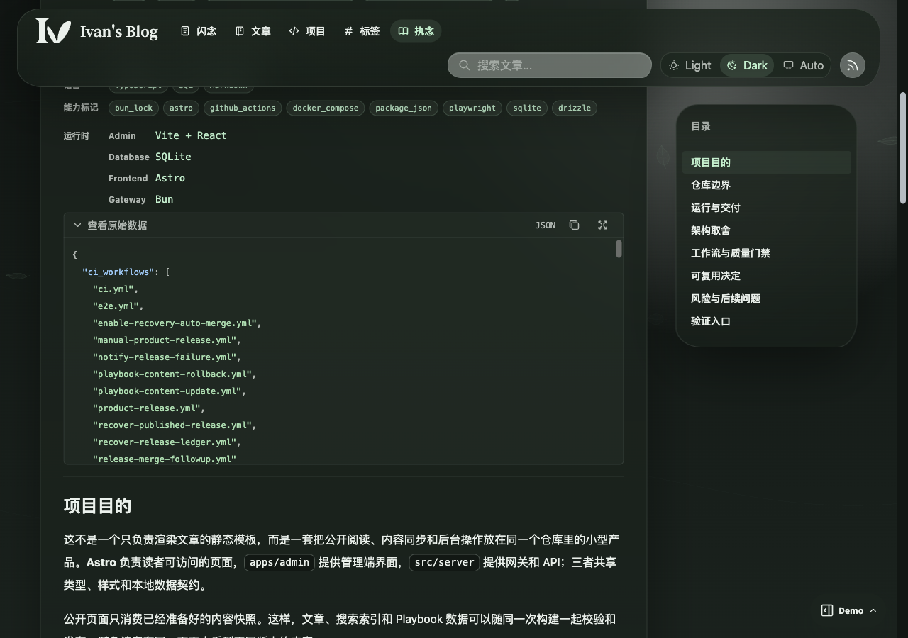
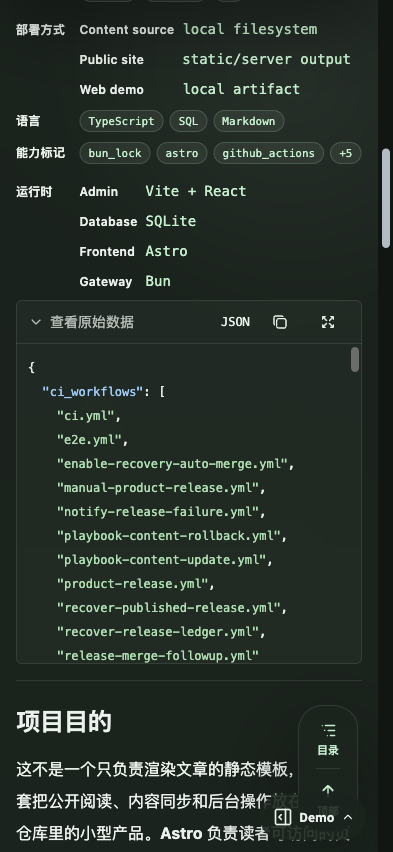

# Style Playbook集成实现状态

## Current Status

- Lifecycle: active
- Implementation: candidate complete；原生阅读、公开资源浏览、双包接收、受保护补充接收、管理员合并浏览、发布链和 console 持久快照已有实现；统一服务端搜索、公开资源正文检索、现代 RAG 版本绑定、异步语义投影与管理员内容同步状态已接入。重型恢复、Mock 投影链路验证、视觉确认和交付门禁尚待完成。
- Catalog note: 原生 Playbook、内容 workflow 和 console 持久快照已落地，生产公开指针已有可校验内容；生产 console 的实际采用版本和运行时同步配置尚未在本工作区核实。
- `REQ-PBI-012`、`REQ-PBI-013`、`REQ-PBI-015` 的既有章节聚合、展开和高亮已实现；统一适配器现在聚合章节与公开资源并返回同版定位，服务端共同排名与全局容量已接入。既有自动化与视觉证据不替代当前 Candidate 的重型验证。
- `REQ-PBI-016` 已在博客消费端实现：详情与索引移除自动生成的内容版本和维护字段，明确异常状态使用中文提示。针对性 SSR、纯函数、静态 smoke、浏览器视觉与格式检查已通过，交付门禁待完成。

## Implementation Coverage

| Requirements | 实现 | 验证 |
| --- | --- | --- |
| `REQ-PBI-001`、`REQ-PBI-002` | Astro 原生目录与详情、真实标题层级、静态子标题 anchor 与当前阅读位置、受控 Markdown、双可见性目录关系、公开文件树和高亮预览及匿名 Policy 资源；公共包与补充包严格校验和归档安全检查，补充包通过受保护接收入口按 source identity 暂存，合并结果仅通过管理员 API 暴露 | `playbook-contract.test.ts` 的完整公开/补充样例、私有字段拒绝、损坏归档、正文原样和 SSR；`playbook-outline.test.ts` 的已有编号、重复标题与锚点一致性；`playbook-resources.test.tsx` 的原文保真、惰性 HTML、同版下载链接及文件引用；管理员路由、补充接收入口和正式 `/playbook/` Web Demo 路由检查；Storybook 仅保留资源浏览器组件场景 |
| `REQ-PBI-003`、`REQ-PBI-004` | 固定 Release 元数据复核、公共/补充资产身份核对、tag commit 核对；首次引导与每小时补漏都选择最高就绪稳定 SemVer，手动入口默认 reconcile；初始公共包获取把补充包作为可选 overlay，未提供补充身份时使用 Release 中已验证的补充包，补充包状态无效、补充身份缺失/部分/失配、二次下载失败或归档解析失败只记录警告并继续公共 seed，同时清除重试残留的旧 supplement 目录 | 模拟 GitHub reader 检查 draft、prerelease、身份不符、未带补充身份仍可采用有效补充、补充资产不完整、补充身份失配或部分字段不阻断公共发布、补充二次读取失败不阻断公共 seed、重试清除陈旧补充目录与最高就绪稳定 SemVer |
| `REQ-PBI-005`、`REQ-PBI-006` | 内容刷新复用已部署 renderer 和独立文章/Memo 快照；正常前端与内容/回滚 job 共享排队锁，锁内重建 | 部署适配器检查幂等、迟到、变化后重建、失败不采用及显式暂停回滚；workflow 结构测试 |
| `REQ-PBI-007` | edition 包含 renderer、来源包和完整公开文件摘要；同批指针、页面、搜索、资源及原始包，保留前一版 | 静态产物校验、身份重算、旧文件保留、不可变与重新验证缓存策略测试 |
| `REQ-PBI-008`、`REQ-PBI-009` | console 启动加载持久缓存/固定 public seed 与可选 admin-only supplement seed；内容 workflow 的构建 seed 和接收状态保留补充包原始数据字节并按 manifest 复验，生产 frozen product inputs、`backend-dist` 与公开镜像只携带 public seed；公共包、补充包、manifest 和缓存投影统一使用 fatal UTF-8 解码，非法字节直接拒绝；接收入口按 source identity 持久化补充状态，立即和每 300 秒单任务同步；统一公共搜索使用 current/previous edition，管理员读模型合并 source-matching supplement；显式回滚后的补充接收只接受当前回滚源或明确允许的更旧目标，拒绝高于当前回滚源的迟到补充，保留已恢复 overlay；初始公共 seed 不因可选补充包失效或 overlay 合并冲突而失败，补充目录按本次输入重建；普通同源空 overlay 继续防止迟到补充，invalid/冲突清除状态可通过同源有效补充恢复；构建未生成合并后的 supplement seed 时隔离补充状态并跳过提交；公共指针二次读取、补充构建、receiver 或冲突 overlay 清理落盘失败只记录告警并由后续补漏重试，不撤销或标失败公共采用；语义投影按同版异步准备，失败不撤销内容采用 | 既有缓存、受保护接收、乱序 source identity、空 overlay、断网/损坏/schema 不兼容、非法 UTF-8、补充包错配、重启、seed 原始字节篡改拒绝、回滚后的迟到补充拒绝、可选补充失效或合并冲突仍保留公共 seed、冲突后清空并重试、invalid 清除后同源有效重试、补充接收失败不阻断公共采用、冲突清理落盘失败不阻断公共采用、构建合并冲突不触发补充提交、公共指针二次读取失败不阻断公共采用、首次 HTTP SSR 及指定 edition 搜索已验证；共同投影失败恢复待 Agent VM 验证 |
| `REQ-PBI-010` | `src/server/services/playbook-search.ts` 将 Topic、项目实践、Policy 正文与公开资源聚合为 edition-bound 候选；现代执行器按 source/type 过滤并用共同 RRF 排名，搜索页发起单一服务端请求 | 适配器、导航、入口回归和正式 Web Demo 的 Topic/Policy 统一列表已通过；跨来源 RAG、真实模型输入隔离仍待当前 Candidate VM 验证 |
| `REQ-PBI-011` | 请求/采用身份记录和整体回滚入口已有实现 | 既有 API 409 与构建/部署适配器测试；现代统一搜索身份与管理员持久历史待验证 |
| `REQ-PBI-012` | 展示层 SearchResultGroup 按来源、类型和规范路由归组；同 edition catalog 提供权威标题与章节位置，单章节直接作为主入口 | Playbook 身份、标题、锚点、Policy/栏目及缺失公开对象测试；文章/Memo 跨类型身份回归 |
| `REQ-PBI-013` | 独立主链接、章节链接和展开按钮；紧凑主摘要与缩进章节附属链接，默认三章节，查询重置、类型筛选保留展开 | 0/1/2/3/5 章节组件测试；1280/393/320px 明暗主题的展开、筛选、查询、键盘与触控 Storybook 断言 |
| `REQ-PBI-014` | 统一执行器使用来源无关的 RRF(k=60)、全局 topK、截断前 source/type 筛选和父内容去重；RAG 判断列表按约定权重参与排序 | Playbook adapter、导航和现有搜索回归已通过；跨来源排序边界待 Agent VM 实证 |
| `REQ-PBI-015` | 主片段与章节共用内联 mark；仅颜色和背景强调，零 padding/margin/border，继承字体、字重与断行属性 | 字体加载后的逐字符几何、换行、容器尺寸、复制及代码缩进对比；六组视口/主题场景 |
| `REQ-PBI-016` | `src/lib/playbook/visitor-reading.ts` 提供消费端纯函数；`PlaybookPage` 仅呈现明确影响适用性的状态提示并移除版本行；入口和分类索引不生成维护字段 | `playbook-visitor-reading.test.ts`、`playbook-contract.test.ts`、静态构建、console 首次响应、无 JavaScript、Web Demo 桌面/移动明暗视觉证据与格式检查通过 |
| `REQ-PBI-017` | 公开 catalog 的 Policy Skill、生成的 `SKILL.md` 和附带资源进入统一词法候选；命中返回同版安全路径与下载/阅读目标 | `playbook-search.test.ts`、公开资源契约回归、正式 Web Demo 资源结果夹具已通过；无 JS 资源定位与完整资源覆盖待 Agent VM 验证 |
| `REQ-PBI-018`、`REQ-PBI-019`、`REQ-PBI-020` | 管理员来源状态增加 Playbook 采用、词法、语义 ready/pending/failed、current/previous 历史；增加按来源 Playbook 刷新动作，语义准备异步且失败独立显示 | 路由、客户端和页面编译检查已接入；持久历史、崩溃恢复与取消边界待 Agent VM 验证 |

## 访客元信息实现

[PlaybookDetail](../../../src/components/playbook/PlaybookPage.tsx) 现在通过 [访客阅读信息适配器](../../../src/lib/playbook/visitor-reading.ts) 读取 `doc_metadata`，只把唯一且明确的 `stale`/`outdated`、`deprecated` 或 `superseded` 状态映射为中文提示；`current`、未知、空值和冲突值均隐藏。标题、简介、标签、目录和正文继续使用各自的语义位置，关联项目继续复用既有公开链接。

详情 Hero、入口和分类索引不再生成 `内容版本` 或发布日期文案；edition digest、请求绑定参数、公开包和缓存身份仍由数据链路保留。没有筛选结果时不生成元信息容器、分隔线或展开控件。固定公开样例覆盖维护字段隐藏和状态映射。

## 搜索实现

[Playbook 查询](../../../src/lib/playbook/search.ts) 用搜索页已绑定 edition 的最小 pages 元数据识别内容；整页、章节和命令归入一个规范路由。未知锚点回退页面且不生成子入口，缺少公开父对象仍作为来源失败处理。父结果按最高单命中分数及原同分顺序排序；章节按锚点去重，按相关性和正文顺序排列。栏目索引保留独立结果，Policy 使用阅读页的安装和资源锚点。

文章/Memo 语义结果和短文本全文结果在排序后按类型及 slug 去重，再截断；纯 FTS 用物化 BM25 候选和分组窗口选最佳行后 LIMIT。公开响应仍为 JSON 数组。短文本路径不再预截取固定数量的原始行，避免重复内容耗尽候选。公共页面与缓存消费同一展示模型，章节及展开不计入内容数量。缓存恢复同时校验可选标题、片段、入口、来源、类型和分数字段，损坏记录视为未命中，避免存储数据导致结果组件报错。

高亮保留原文字切片，并通过普通内联 mark 继承上下文排版。代码块保留既有 Markdown 展示缩进规则；高亮开关不改变复制文本或字符位置。浏览器验收包含重复中文、紧邻标点、中英文、部分连字、长行及代码。

当前搜索展示使用单一服务端结果列表；来源、类型和模式进入请求与 URL，旧版 `edition`、`sourceReleaseId`、`sourceTag` 只兼容接收并由服务端和页面清理，不参与版本选择。请求开始时固定当前采用 Playbook 快照，分类筛选在候选和全局 topK 之前执行。Playbook 正文、章节、Policy `SKILL.md` 及公开资源按父内容聚合，现代 RAG 可读取同版候选并把资源作为不可信证据传给模型；rewrite 仍只为博客生成查询。语义投影缺失时保留同版词法候选并报告 `ragIncompleteSources`，阅读/资源路由和内部投影继续使用完整 edition 身份。

搜索输入外框采用 Nature 胶囊轮廓，与图标搜索按钮的正圆匹配；按钮直径 44px，右侧与上下内缩一致。平板保留带文字的胶囊按钮，悬停使用颜色反馈而不改变按钮位置；加载状态保持输入外框高度。主人认可圆角协调，并要求降低搜索框高度、加宽桌面左栏。当前搜索候选同步最新主线后的仓库 823 项测试、32 个搜索交互场景及 Storybook、Web Demo、静态站和 console 构建通过。浏览器实测输入外框高 54px，图标按钮为 44px 正圆，上、下、右三侧内缩均为 5px；1280、393、320px 明暗主题及 768、1024、1536px 无横向溢出，悬停和聚焦不移动按钮，加载状态外框高度仍为 54px。桌面左栏在 1024px 实测 320px，在 1280、1536px 实测 352px，栏间距均为 32px。明暗主题截图已刷新并由主人确认，已保存为正式搜索视觉证据。

## Validation Evidence

以下保留既有功能的候选验证记录，不据此推断当前生产 console 的同步状态，也不把这些证据计为统一服务端搜索、公开资源正文检索或内容同步管理的验收。

搜索聚合候选同步到主线 `8bfc0b602fd849bc129763c97c46821afc9749be` 后，在会话 Agent VM 使用 Bun 1.4.2、Node 22.12.0 与 Playwright Chromium 执行验证：双栏、统一列表及控件比例候选 `b1539460c196c544fa0e5bf84216ff2a89acad31` 的 `bun run test:precommit` 为 823 pass、0 fail，32 个搜索 Storybook play 场景通过，包含两栏边缘对齐、操作区筛选与建议词启动新查询，以及跨来源交错结果的输入顺序、单一列表和来源标题缺席断言。`bun run check` 无失败，仅有三条既有告警。文件权限回滚测试在移除 VM root 的 DAC 绕过能力后执行，保持只读文件的真实权限语义。

`VER-PBI-012` 与 `VER-PBI-014` 覆盖权威标题、章节/命令归组、跨类型身份、单章节入口、缺失父对象和锚点回退，以及 Playbook 60 命中、全文 250 重复行、语义去重与 v5 缓存；`VER-PBI-013` 覆盖章节数量边界、展开/收起、筛选保留、新查询重置、无嵌套入口、Tab 顺序、44px 目标和无横向溢出。`VER-PBI-015` 等待字体加载后，在 1280/393/320px 明暗主题中逐字符比较文字坐标、尺寸、断行和复制文本，包含部分连字与代码；所有差异不超过 1 CSS px，断行和复制完全一致。

搜索页面证据从 Web Demo 的 `/search/?q=版本` 捕获，组件展开证据从 `Public/Search Results/Expanded` 捕获；主人确认后将当前图片写为正式 Spec 资产。搜索展示保留 Nature 主题，主标题旁使用轻量类型标识；至少 1024px 时改为左侧 20rem 搜索操作栏（1280px 起为 22rem）、右侧自适应结果栏，输入框、分类筛选与建议词集中到操作栏。窄屏仍为上下排列；既有建议词优先，没有建议时使用输入框的 Arch、React、SQLite 示例词，不新增请求。章节使用两列附属链接、移动端使用单列，并通过缩进与间距表达归属。移除目录竖线、逐行分隔与章节箭头。主摘要与章节 prose 片段最多两行，Playbook 短预览停在当前段落；索引上下文从匹配所在段落开始，避免前一段占据预览而隐藏关键词。代码沿用原有多行缩进。摘要使用完整行省略，移除内部悬停阴影与父卡片位移，窄于 375px 的主入口同步使用 12px 阅读边距。当前候选的 Storybook、Web Demo、静态站和 console 构建及 HTTP smoke 通过；Web Demo 在 320、393、768、1024、1280、1536px 无横向溢出，桌面左栏随断点为 320/352px、栏间距 32px，左右边缘与共享内容容器对齐。组件证据表面使用自然主题背景，目标四侧实测边距均为 32px。来源分区已移除；统一列表的 32 个交互场景、Storybook 和 Web Demo 构建、静态站与 console HTTP smoke 通过。统一列表的桌面与移动明暗截图已刷新，结果区域只包含内容标题和一个顶层结果列表，无来源标题；最新的搜索框高度、左栏宽度与明暗主题展示已由主人确认，正式图片与组件展开证据已写入 Spec。

页面级验证使用独立的 Web Demo 构建物；实际静态 HTML 和 console 首次 HTTP 响应包含 Playbook 正文与 anchor，版本化 Playbook search-index/resource API 继续按完整 edition 身份读取并对未知版本返回 409，现代搜索请求则固定当前快照并忽略遗留版本字段。正式路由上的共享 Inspector 提供可复现的场景、身份、网络、数据、模拟操作和 `d_*` 分享状态，并且不触达真实写接口。Storybook 构建只验证组件/资源/搜索状态，不再承担页面级证据。仓库测试与提交门禁测试均通过后，需重新验证受影响的静态站、Web Demo 构建、Storybook 构建与 HTTP SSR。`bun run check` 保留仓库既有告警，不引入新的检查失败。

视觉证据覆盖 390/768/1280 宽度及明暗主题，使用公开控制样例，无登录或来源仓库访问。Spec 中保存已确认的证据。正文前目录复用 `nature-panel nature-mobile-reading-surface`：640–1023px 呈现与正文一致的主题卡片，小于 640px 由共享响应式契约覆盖为全宽平面阅读层。768px 明暗主题场景直接比较目录与正文的背景、边框、圆角、阴影与宽度，截图见 Spec；移动端平面目录与桌面吸附目录回归另行验证。当前 Candidate 的正式审查和 live PR 状态仍属于交付门禁，尚未通过的门禁不计为已完成验收。

Policy 公开资源使用 SSR 文件浏览器：可收起的原生目录树、精确文本源码、现有主题高亮、Markdown 阅读/源码切换与同版下载。公开资源与正文、目录为同层区域，正文结束后独占一行：桌面端主题卡片横跨两栏，移动端复用 `nature-mobile-reading-surface` 的全宽平面阅读承载层，按共享边距内缩内容，去掉外层圆角、边框和阴影；展开文件树时仅在树内定位当前文件，保持页面阅读位置。资源标题右侧提供放大/退出按钮。通过原生 dialog 的 top layer 铺满视口，将同一个工作区移入其中，保留现有文件、预览方式与阅读状态，避免重复渲染和文件 ID 冲突；原位置保留等高占位。放大时锁定页面滚动并使用原生模态焦点约束，退出、原生取消和卸载统一恢复工作区、页面 overflow 与焦点；移动文件树优先响应 Escape。全屏工作区采用 dvh 与安全区边距，目录仍按当前工作区的容器宽度使用侧栏或浮层。手动安装与依赖规则仍在正文。文件树与原文源码使用透明底色，与工具栏一起透出同一资源卡片表面，保留分隔线与文件选中状态。Astro 使用局部 DOM 增强，页面请求不加载上游；无 JavaScript 通过原生折叠文件预览阅读。受控样例覆盖多级目录、脚本、Markdown、JSON 与未知扩展文本。文件预览的 6 个单元测试、栏目与搜索 Storybook 交互场景及静态站、console、Storybook 构建通过；HTTP 下载内容与采用版本的文本逐字一致。公开资源的桌面、移动与明暗主题场景核对正文分离、单行全宽及文件下载；移动场景还检查共享阅读承载层的两侧位置、12/16px 阅读边距、零圆角/阴影/外边框及 44px 文件和工具控件触控目标。390/320 宽度未出现横向溢出，关闭目录后保留当前文件，重新展开可恢复选择；公开脚本样例的源码文字最低实测对比度为浅色 4.96:1、暗色 8.67:1。Markdown 阅读先提取 frontmatter，以紧凑键值列表呈现元数据，避免分隔符被误识别为正文标题；使用现有 js-yaml 的数据 schema，解析失败保留元数据原文，完整源码和同版下载不变。验证覆盖 YAML、JSON 形式元数据、多行文本、嵌套值、BOM/CRLF、非法标签、重复键与正文分隔线，另有 Skill 阅读/源码切换的桌面、移动及明暗 Storybook 场景。增强预览按稳定视口高度分配工作区：桌面为 68svh、限制在 28–40rem，移动端为 70svh、限制在 28–36rem。切换文件、阅读/源码与文件树显隐保持工作区总高；工作区宽度小于 640px 时，文件树默认收起，以工具栏下方的非模态浮层展示，宽度不超过 18rem、高度不超过 26rem 且限制在工作区内，预览区域不因展开而缩小。文件选择、点击浮层外部、关闭按钮和 Escape 均可收起；关闭按钮与 Escape 返回工具栏焦点，展开后聚焦并在树内显示当前文件。开合采用 160ms 位移与透明度动画，尊重减少动态效果偏好；快速切换会取消前次动画，收起时立即移出可访问性与键盘焦点路径。ResizeObserver 在工作区宽度跨越断点时恢复适当的侧栏/浮层状态，并在卸载时清理事件、动画与观察器。文件树、阅读与源码各自滚动，工具栏固定。长路径省略展示并保留完整文本与悬停提示；无 JavaScript 仍使用原生折叠项的自然文档高度。11 个受影响的 Storybook 交互场景通过，覆盖浮层几何尺寸、选择后收起、外部点击、Escape、焦点返回、默认收起，以及长文、120 行脚本与短文本在 1280、390、320 宽度的切换；键盘可滚动至阅读与源码末尾，页面无横向溢出。静态站、console 与 Storybook 构建通过。仓库 `AGENTS.md` 与根 `DESIGN.md` 指向 Nature UI 响应式契约和 ADR 0003，功能 Spec 明确继承共享规则。放大显示另有 7 个桌面、平板、移动及窄屏交互场景，检查视口尺寸、原 DOM 和当前文件不变、阅读/源码及滚动位置、按钮/Escape/原生取消退出、背景滚动锁定与焦点返回；浏览器真实 Tab 与 Escape 输入验证模态焦点约束和退出清理。内部滚动位置在 DOM 移入/移出 dialog 前保存，并按可见滚动区恢复；不同文件和预览模式的滚动位置分别记录。文件浏览器截图经主人确认后保存为正式证据。

## Remaining Gaps

- 统一服务端入口、跨来源共同排名、全局 topK、截断前范围筛选与现代搜索版本元信息已接入，详见 [统一搜索接口](../search-relevance/contracts/unified-search.md)；当前 Candidate 仍需重型验证；本次模型和 embedding 提供方均使用 Mock，不调用真实外部服务。
- Policy 公开资源文件已由同版公开 catalog 准备检索候选并返回安全路径，语义投影按 edition/model/content hash 异步去重；完整崩溃恢复与无 JavaScript 定位验收待验证，现有发布包无需读取私有源文件。
- 管理员内容同步页已纳入 Playbook 来源、按来源刷新和独立语义状态；持久任务历史、取消与采用边界需要在 Agent VM 故障注入中验证。
- 当前候选的 Playbook 纯函数、双包接收、管理员 API、SSR、静态/Web Demo/console 构建、视觉证据和格式检查已完成；新增页面截图为 current-only，待 owner 确认后才能冻结候选，受影响的独立审查与 live PR 当前 head 门禁仍待完成。实现覆盖不等同于交付完成。
- 上游原生 Release 负责发布可重复公开包，并在数据包之后最后上传 manifest；博客通过每小时补漏读取最新就绪稳定版，不要求上游调用博客 Actions API。见 [公开包契约](./contracts/public-package.md) 和 [触发契约](./contracts/release-trigger.md)。
- `PLAYBOOK_SOURCE_TOKEN` 提供上游只读访问；生产更新仍须在首次应用部署验证指针后手动启用。首次引导自动选择最高的就绪稳定 SemVer，不需要固定 Release ID。
- 真实 EdgeOne 原子发布、生产指针及 console 五分钟跟随由两仓合并后的上线阶段验证；模拟适配器与本地 HTTP 结果不替代生产验收。
- 本任务不触发真实 Release、不配置远端凭据；PR 合并按交付流程的 Step 5C 版本确认和 CI/review 门禁执行。上线顺序和暂停/回滚流程见 [发布 runbook](../../runbooks/style-playbook-publishing.md)。

## 内容同步统计与语义准备缺口

只读页面与管理接口核对确认，当前 local 有 324 个内容对象、当前 Playbook 有 80 个独立内容对象；来源列表同时返回两者，但来源摘要返回 registeredSources=1、enabledSources=1，总内容量仍为 324。按 `REQ-PBI-018` 的当前已采用唯一内容口径，此数据集合的总量应为 404；章节、资源、分块和 previous edition 不再次累计。这是项目实现漏统计，不能以运行时缓存或部署版本解释。

`getManagerStats` 直接使用本地 `ContentSourceManager`，Playbook 仅在 `getSourcesStatus` 中追加；`getContentStats` 只统计 posts。管理器的累计次数与最近时间来自有长度上限的进程内历史，重启归零，历史截断还会减少“累计”数。Playbook 行固定 enabled=true，以有采用快照冒充 online，并将包生成时间用作最近同步时间；已有快照、实际启停、远端可达性、最近检查与最近采用必须分开核对。自动轮询未进入手动检查的持久日志，两个已知 edition 配合零条检查历史不能证明从未同步。

博客向量摘要的 indexed 统计当前模型的 post_embeddings 行数，仅判断无错误信息；outdated 固定为 0，unindexed 只以已有记录数减 indexed。分块数量没有标明单位，未建记录、失去父内容、内容变化、模型变化、空向量和损坏向量均不能由该摘要正确表达。Playbook 状态只统计当前完整 edition/model 下已有的 search_semantic_embeddings 行，没有从已采用语料建立预期总量；无记录时 total/ready/pending/failed 同为零，UI 又不显示 total。因此该摘要不满足真实语义覆盖要求。

自动轮询和 Console 启动恢复没有调用 Playbook 语义准备器，准备器目前只在手动 Playbook 检查回调使用；全量向量化只处理 post/memo。准备器逐块创建 pending 行，未遍历分块没有持久待补状态，启动也不恢复准备进度。自动采用、首次 seed、相同版本补建、取消或退出重启以及有效模型改变的语义准备需要同一恢复边界。查询路径仍不得触发全量生成。

上述诊断确认了项目实现缺陷；对应修复见下文“内容同步与 RAG 修复实现”。本次实现没有执行生产同步、向量生成、数据清理或部署。观察到的旧向量与 Playbook 空投影属于运行数据现状，不能据此推断提供方故障；它们也不改变统计代码及恢复路径存在缺陷的结论。具体语义统计与覆盖标记由搜索主题定义。

## References

- [长期需求](./SPEC.md)
- [公开包契约](./contracts/public-package.md)
- [Release 触发契约](./contracts/release-trigger.md)
- [研究基线与主题历史](./HISTORY.md)
- [ADR 0011](../../adr/0011-published-playbook-read-model.md)
- [ADR 0024](../../adr/0024-unified-search-and-playbook-sync-management.md)

交付遵循主线的手动产品发布合同。普通实现 PR 不改 VERSION、不自动发布；Release Policy 的兼容性证据覆盖当前搜索代码、测试和文档 blob。搜索修复保持公开数组 API、权限和持久 SQLite/local content 格式兼容，属于 patch 影响；整个可信基线后的未发布区间仍包含主线已有 minor 能力，保留区间级 minor 分类。

审查发现多词查询的摘要定位假定查询必须连续出现。摘要现在优先使用完整查询，找不到时使用检索器返回的实际命中词定位；通过归一化位置映射保留原文字切片，覆盖分散关键词、末词前缀、模糊匹配及全角正文。两个失败复现修复后，9 个 Playbook 搜索测试及 823 项仓库测试通过，32 个搜索交互场景与各构建 smoke 通过；单词查询的既有段落定位和已确认视觉保持不变。

PR #172 的首轮自动 CI 中九项必需检查通过，guest E2E 暴露旧卡片 DOM 选择器、移动按压反馈选择器与浅色标题实测 4.40:1 的对比度问题。当前修复使用稳定的搜索内容属性与既有类型标识，反馈直接作用于实际主链接，并将浅色移动结果的绿色强调色加深至 `#456f54`；保持 4.5:1 验收阈值和原有边距、触控、焦点断言。修复在会话 Agent VM 通过 823 项仓库测试、34 个搜索 Storybook play、受影响的三个 guest E2E 场景及 Storybook、静态站、console 和 Web Demo 构建；浏览器覆盖九个响应式/主题场景，字体加载后高亮字符位置、换行与复制文本断言通过。格式检查通过，保留三项既有警告与一项提示。浅色手机强调色的最终截图已由主人确认，五张最终证据已落盘；当前候选仍须刷新受影响审查与 PR 必需 CI 后才能宣告 merge-ready。

## 项目技术栈实现与证据

`REQ-PBI-021` 由 `PlaybookTechStack`、`PlaybookTechStackChips`、`PlaybookTechStackRaw` 与纯函数解析器实现。ResizeObserver 和字体就绪后的实测宽度决定可见 chip 数量；隐藏测量区不扩大页面。原始数据工具栏开合复用固定几何尺寸，展开仅显现不占布局空间的内描边和下方 JSON，折叠保持平面。共享 tooltip 解释复制与全屏图标，原生 dialog 提供视口级阅读。

正式 Web Demo `/playbook/projects/blog-26/` 使用仓库实际工具链及完整项目上下文。桌面 1280px、移动 393px 和窄屏 320px 核对无横向溢出、chip 单行和标签键盘切换；原始面板开合的工具栏、箭头、文字、JSON 标签与操作按钮坐标差均为 0px。工具栏与代码区左右内缩均为 12px。页面视觉效果由主人确认，代码修改与恢复在 Web Demo 开发服务中自动生效；构建预览仍是独立固定产物。

禁用 JavaScript 的静态页面提供原生 details 入口读取完整筛选 JSON。复制 API 与旧式复制同时失败时清理临时 textarea、显示失败反馈并展开内容供手动复制；组件交互场景覆盖异常清理与文本选择。Web Demo 搜索链接在构建时绑定同一准备产物的 edition 身份，避免现实项目 fixture 更新后跳入不存在的旧版本页面。

## 内容同步与 RAG 修复实现

REQ-PBI-018/019/020 的实现使用统一状态接口、共享目标目录、0015 前向迁移和持久来源任务。四张摘要卡纳入 local 与 Playbook，收录量按当前唯一父内容；RAG 主卡按公开父内容、详情按预期分块。生成和消费复核同一配置指纹、输入与完整 edition，任务取消持久记录，向量与目标有效性记录同事务提交。当前候选正在验证，尚未达到交付 Ready；生产历史向量和空 Playbook 投影仍需另行授权补建，不能以本地通过代替生产完成。接口细节见 [统一同步状态](./contracts/content-sync-status.md)。

本次内容同步与 RAG 缺陷修复的验收以确定性 Mock 提供方覆盖生成、持久化、重启、覆盖统计和现代 RAG 消费链路，以及超时、取消、维度变化与迟到写入。按主人明确约束，不执行真实 chat/embedding 调用、不读取或转移真实提供方凭据；原计划 A6 的真实提供方实证要求由此替换。Mock 结果只证明项目链路与契约，不声称验证外部提供方可用性或真实语义质量。

管理页 RAG 范围使用“全部 / 博客 / Playbook”单选 chip，选中状态通过 `aria-pressed` 表达，支持 Tab 与 Enter/Space；来源切换重置为当前 edition，统计与补建/重建共享所选范围，上一版仅提供只读详情。页面级浏览器回归使用正式 `/admin/content-sync` 路由与内存 Mock，覆盖范围、取消保留进度、未知覆盖和停用缓存。

来源恢复先执行与管理入口共用的本地注册逻辑；本地 singleflight 在异步启动前绑定运行 Promise，等价请求共享原任务与结果，全部来源仍继续 Playbook 检查。0015 的来源任务附带可空 result，保存本地实际 created/updated/deleted/skipped 和 Playbook 采用前后数量；旧任务不可还原的变化数为 null，兼容历史保留 created 并提供 added 别名。重建尝试与已提交覆盖分开，失败/取消保留未变更的有效向量；只有新结果成功才原子替换。

本地恢复采用持久工作清单与逐项游标，写入和统计检查点同事务提交；全量初始清空和工作清单也同事务提交，恢复只继续余项。采集器操作标签不决定实际变化：数据库不存在的内容计创建，已有同内容计跳过。初始化、采集、文件读取失败与无需更新形成不同持久终态。旧部分任务缺少可靠清单时失败而不猜测重放；旧取消接口保留内容同步范围，不取消 RAG 任务。

任务的跨进程执行围栏由 `content-tasks.ts` 管理：每次接管建立新的持久执行 token，活跃任务有可续租的 ownership，旧执行者不能写入内容、投影、进度或终态。恢复扫描在启动和轮询时执行，等价跨进程请求复用原 taskId。本地全量同步取消不再经过提前清空数据库；仅完成全部清单后清理当前启用来源的过期内容。Playbook 的文件采用点受同步 SQLite 事务取消围栏保护。
