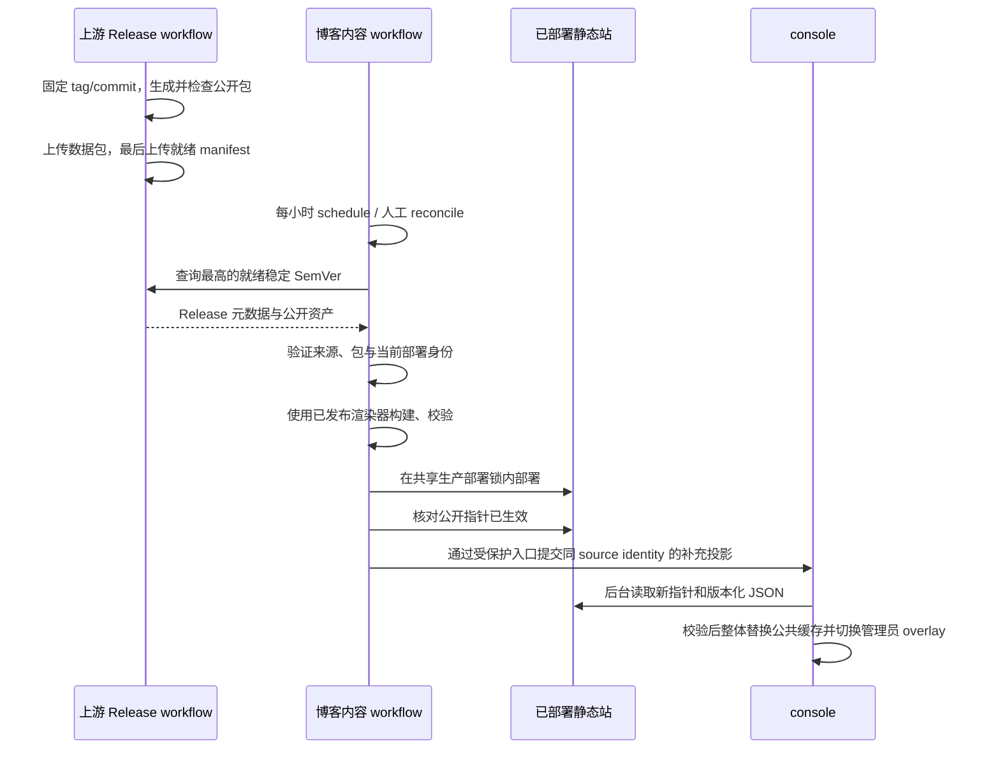

# Style Playbook Release 触发契约

本契约定义上游稳定发布完成后如何启动博客内容构建，覆盖 `REQ-PBI-003`、`REQ-PBI-004`、`REQ-PBI-006` 和 `REQ-PBI-011`。目标 workflow 已在博客实现；相关凭据和生产启用属于上线阶段，当前状态见 [IMPLEMENTATION.md](../IMPLEMENTATION.md)。

## Participants and Boundary

| 参与方 | 职责 |
| --- | --- |
| `IvanLi-CN/style-playbook-skills` Release workflow | 生成并发布固定版本公开数据 |
| `IvanLi-CN/blog-26` 的 `playbook-content-update.yml` | 每小时检查最新就绪稳定版本；也支持人工触发，校验来源、构建并部署公共静态站，并校验补充包输入 |
| `ivanli.cc` 已部署 manifest | 记录实际已生效的Playbook身份，供去重、版本判断和 console 同步 |
| `console.ivanli.cc` | 在博客部署后读取公开指针，独立执行公共缓存同步；管理员后端从受保护接收入口暂存并按 source identity 合并私有补充目录 |

上游 Release workflow 可以在资产就绪后通过既有 `workflow_dispatch` 合同通知 Blog；主要补漏入口仍是博客自身每小时的 `schedule`，人工操作使用同一个 `workflow_dispatch`，默认执行 `reconcile`。上游只需要 Blog workflow 的 dispatch 权限，不需要读取 Blog 源码或修改 Blog 仓库内容；通知失败时不影响 schedule 补漏。



## Upstream Publication Readiness

上游 Release 必须为稳定版本，且固定到已通过该仓库发布门禁的 tag/commit。公开数据资产采用两个固定名称：

- `playbook-public.tar.gz`：经过公开检查的目录、正文与搜索数据。
- `playbook-public-manifest.json`：schema 版本、来源仓库、Release ID/tag、解析后的 commit、文件清单及 SHA-256/大小，以及数据包的名称、SHA-256 和大小。

就绪 manifest 是单独的 Release asset，必须在数据包上传成功并核对 digest 后最后上传，避免数据包把自身 digest 包进自身的循环定义。缺少完整 manifest 的 Release 不具备构建资格。同一 Release 重跑必须核对既有资产，不得覆盖为不同内容。上游发布 job 在预检、创建 Release 以及每次资产上传前都重新确认仓库仍为 private；任一检查失败都不得继续上传。

上游至少需要成功发布两个公开资产；包含非公开整理知识的 Release 还必须成对发布 `playbook-private-supplement.tar.gz` 与 `playbook-private-supplement-manifest.json`。补充包不改变公共 pointer，也不进入公共静态站；博客接收端会把它作为同一 source identity 的 admin-only overlay 校验，并在公共 pointer 校验成功后提交到受保护 console 入口。canary、draft、无发布意图或公开检查失败的 Release 不会被博客选中。上游通知只是加速路径，博客仍会在下一次补漏时自行发现已就绪版本。

## Dispatch Interface

目标 workflow 文件为 `.github/workflows/playbook-content-update.yml`，需要先进入博客默认分支。控制 workflow 的 `ref` 固定为 `main`；实际渲染器另行固定到已发布前端 commit，不能将控制 workflow 的 ref 当成渲染器版本。

人工触发接口：

```text
POST /repos/IvanLi-CN/blog-26/actions/workflows/playbook-content-update.yml/dispatches
```

请求使用 GitHub REST API 版本 `2026-03-10`，默认执行无来源参数的补漏检查：

```json
{
  "ref": "main",
  "inputs": {
    "mode": "reconcile"
  }
}
```

| Input | 约束 |
| --- | --- |
| `mode` | `reconcile` 查询并固定最高就绪稳定版，为默认模式；`release` 用于人工提交固定来源身份后的重试 |
| `source_repository` | `release` 模式必填，必须精确匹配唯一允许的上游仓库 |
| `source_release_id` | `release` 模式必填，Release 数字 ID，以字符串传递 |
| `source_tag` | `release` 模式必填，必须与该 Release 的稳定 tag 匹配 |
| `source_sha` | `release` 模式必填，40 位十六进制 commit，必须与 tag 解析结果一致 |
| `bundle_sha256` | `release` 模式必填，必须与就绪 manifest 和下载包一致 |
| `manifest_sha256`、`bundle_asset_*`、`manifest_asset_*` | 可选的公共资产身份；一旦提供必须完整且与 Release asset digest/size 一致 |
| `supplement_bundle_sha256`、`supplement_manifest_sha256`、`supplement_*_asset_*` | 可选的补充资产身份；提供时必须完整且与补充 manifest、Release asset digest/size 一致；缺失、部分或失配只使本次管理员 overlay 不可用，不阻断公共发布 |
| `source_run_id` | 来源运行关联信息；人工重试可省略，不作为来源授权依据 |

GitHub input 定义中，来源字段允许为空以支持 `reconcile`；接收 job 必须按模式执行上述必填与一致性检查。`reconcile` 不接受调用者注入候选来源，在内部读取固定上游的 Release 元数据并生成同一组固定输入。普通触发接口没有回滚模式，回滚通过单独的显式操作处理。

GitHub API 接受人工请求仅代表 workflow 已提交排队，不能把 HTTP 成功标为静态站已经更新。生产默认入口是定时补漏，不依赖上游调用此 API。

## Credentials

| 使用位置 | 所需授权 |
| --- | --- |
| 博客下载/补漏 job | `PLAYBOOK_SOURCE_TOKEN` 对私有上游仓库的 `Contents: read`，用于读取 Release 元数据和资产 |
| 博客部署 job | 复用博客自己的 EdgeOne 部署凭据 |
| Blog 到 console 的补充同步 | `PLAYBOOK_SUPPLEMENT_SYNC_TOKEN`，只允许调用受保护的 `/api/admin/playbook/supplement` 接收入口；可用无凭据的 HTTPS `PLAYBOOK_SUPPLEMENT_SYNC_URL` 指向 console 地址 |

博客侧的上游读取 PAT 与 Blog 到 console 的同步令牌职责分离。同步令牌只用于提交经过校验的补充投影，不授予 GitHub 仓库写权限；console 与访客只读博客公开 JSON，管理员入口才读取补充缓存。

## Receiver Processing

1. 解析事件和模式。`schedule` 等价于 `reconcile`；默认手动模式也是 `reconcile`，`release` 从输入固定候选。读取当前部署身份及自动更新是否暂停。
2. 查询固定上游，确认 Release 非 draft/prerelease、tag/commit 对应且就绪资产完整；`reconcile` 选择最高 SemVer 的就绪稳定版。下载后校验公共 schema、来源、digest 和公开契约；若存在补充资产，还要校验补充 schema、source identity、digest、大小、固定根文件和 overlay 关系。人工来源参数只作为待核对声明，不作为可信内容。
3. 对比已部署指针。相同 Release/digest 已生效时跳过；同一 Release 不同 digest 拒绝；较旧稳定版本跳过，不直接信任 API `latest` 作为版本顺序。
4. 固定当前已发布的博客渲染器与文章/Memo 输入，构建并执行静态校验。
5. 获取与正常前端部署相同的生产 job 并发组，再重新读取部署身份。若内容已被采用或已变旧则跳过；若当前渲染器已改变，则不得部署旧渲染器产物，需要重新构建后再核对。
6. 部署完整公共页面及版本化数据，核对公开指针已生效，再把同一 source identity 的补充投影提交到受保护 console 接收入口；若 Release 没有补充包则提交明确的普通空 overlay，同一 source identity 已接受的补充包或普通空 overlay 都不得被缺失资产或迟到重试改写，只有 source 切换才会清理旧 overlay；补充失效或合并冲突时提交带 `supplementStatus: invalid` 的同源空 overlay，该清除可被同源有效补充重试。显式 rollback 请求携带受保护的 `rollback=true` 标志，并且只允许暂存严格早于当前 stable source 的补充投影；待公共同步采用该 source 后再恢复管理员读模型，普通乱序旧请求仍必须拒绝。若暂存补充投影无法与之后采用的公共 edition 合并，公共 edition 仍必须成功采用为 public-only 结果，并隔离该 source 的管理员 overlay；随后可通过同源 invalid 空补充请求清除冲突状态后重试。补充状态和构建时的补充 seed 都必须保留 manifest 对应的原始数据文件字节，加载或重启先复验文件摘要和投影一致性。记录实际采用的公共/补充输入身份与下游 run URL。接收端先按来源身份暂存，console 的公共同步采用同一来源后才向管理员读模型合并；补充数据不能被静态站或匿名 API 读取。

生产 job 并发组使用 `blog26-edgeone-production` 与 `cancel-in-progress: false`，由内容和正常前端部署共同使用。GitHub Actions 原生并发只保留一个运行中的任务和一个待处理任务；两种流程之间需要同一个部署 job 边界。待处理任务仍必须执行版本与渲染器复核，不能依赖 dispatch 时间保证顺序。

## Reconciliation and Failure Outcomes

博客 workflow 自身每小时第 17 分钟执行一次补漏检查；发现更高的就绪稳定版本后才构建。这个间隔与 console 部署后约五分钟的缓存同步间隔是两件事。

定时运行由 GitHub 排队，可能延迟或漏跑，因此是补漏手段而非严格一小时恢复保证；公开仓库长期无活动导致 schedule 被停用时需要恢复。手动 `mode=reconcile` 可以执行同一检查。显式内容回滚期间允许暂停自动更新，恢复前核对当前版本与上游候选，防止补漏立即撤销回滚。

| 结果 | 处理 |
| --- | --- |
| 上游数据生成、公开检查或上传失败 | 不完整资产不构建；后续补漏会重新检查 |
| 博客构建或部署失败 | 博客 run 记录失败，保留生产旧版本；后续补漏或人工重试 |
| 重复或较旧稳定版本 | 记录跳过，不重复部署或降级 |
| 下游部署期间渲染器发生变化 | 丢弃过时构建产物，使用新已发布渲染器重新构建 |
| 部署成功、console 下载失败 | 静态站提供新版本，console 继续最后兼容缓存并后续重试 |

## References

- [SPEC.md](../SPEC.md)
- [GitHub workflow dispatch REST API](https://docs.github.com/en/rest/actions/workflows#create-a-workflow-dispatch-event)
- [GITHUB_TOKEN 的仓库范围与事件触发](https://docs.github.com/en/actions/concepts/security/github_token)
- [workflow_dispatch 与 schedule 事件](https://docs.github.com/en/actions/reference/workflows-and-actions/events-that-trigger-workflows)
- [GitHub concurrency 队列](https://docs.github.com/en/actions/how-tos/write-workflows/choose-when-workflows-run/control-workflow-concurrency)
